# System Architecture Document — CyberShield

**Document Identifier:** ARCH-CYBER-SHIELD-001  
**Product Name:** CyberShield (Enhanced MVP)  
**Architecture Version:** 1.0.0-PROPOSED  
**Status:** Approved for Implementation  
**Primary Reference:** [`PRD.md`](file:///c:/Users/Bhuvan%20A/OneDrive/Desktop/project/projectt/PRD.md)  
**Authors & Roles:** Principal Software Architect, Application Security Architect, Senior Full-Stack Engineer, Database Architect  

---

## 1. Document Overview

### 1.1 Purpose
This document establishes the authoritative technical architecture and system design for **CyberShield**. It defines the architectural patterns, structural boundaries, component interactions, data movement, execution contexts, security boundaries, and operational characteristics required to implement the CyberShield Enhanced MVP. It translates the product requirements specified in [`PRD.md`](file:///c:/Users/Bhuvan%20A/OneDrive/Desktop/project/projectt/PRD.md) into concrete engineering design specifications.

### 1.2 Intended Audience
- **Autonomous AI Coding Agents:** Definitive blueprint for scaffolding the repository, organizing modules, adhering to dependency constraints, and enforcing execution boundaries.
- **Full-Stack & Frontend Engineers:** Structural guide for component hierarchies, state management, routing, and styling patterns.
- **Cybersecurity & AppSec Engineers:** Specification of threat trust boundaries, sanitization protocols, and zero-retention privacy models.
- **DevOps & QA Engineers:** Guidelines for automated CI/CD pipelines, Vercel edge deployment, environment variable governance, and testing boundaries.

### 1.3 Scope and Disclaimer
This architecture addresses the **CyberShield Enhanced MVP**. It covers the client-side detection engine, presentation layer, routing, animation choreography, Supabase Backend-as-a-Service (BaaS) edge integrations, and Vercel hosting. 

> [!NOTE]
> This document specifies the *proposed system design* and architectural contracts. It does not certify that the application has been deployed or verified in production.

### 1.4 Terminology & Acronyms
| Term / Acronym | Definition |
| :--- | :--- |
| **ADR** | Architecture Decision Record. |
| **BaaS** | Backend-as-a-Service (specifically Supabase PostgreSQL, Auto-generated REST APIs, and Deno Edge Functions). |
| **CSP** | Content Security Policy HTTP headers. |
| **DOM** | Document Object Model. |
| **Edge Function** | Serverless TypeScript function executing on the Deno runtime at edge locations via Supabase. |
| **Homoglyph** | Characters with different code points that appear visually identical or very similar (e.g., Latin 'a' vs. Cyrillic 'а'). |
| **RLS** | Row Level Security policies enforced in PostgreSQL. |
| **SPA** | Single Page Application (React / Vite). |
| **SSRF** | Server-Side Request Forgery. |
| **Typosquatting** | Registering deceptive domain names that target common typographical errors made by users. |

---

## 2. Architecture Summary

### 2.1 Architectural Style
CyberShield implements an **Explainable, Client-First Single-Page Application (SPA) architecture with Serverless Edge Extensions**. The architectural baseline prioritizes:
1. **Zero-Latency Client-Side Evaluation:** Pure, deterministic TypeScript detection heuristics run directly in the browser runtime, guaranteeing immediate analysis without network latency.
2. **Zero-Knowledge Privacy:** User-submitted text, links, and metadata are processed transiently in browser memory, never written to disk or database tables.
3. **Stateless BaaS Decoupling:** Supabase provides serverless infrastructure (Edge Functions for trusted operations/telemetry and managed PostgreSQL for optional anonymous feedback) without requiring a bespoke, self-hosted Node.js/Express server.
4. **Edge CDN Distribution:** Static assets, JavaScript bundles, and pre-rendered awareness guides are served via Vercel’s global Edge Network.

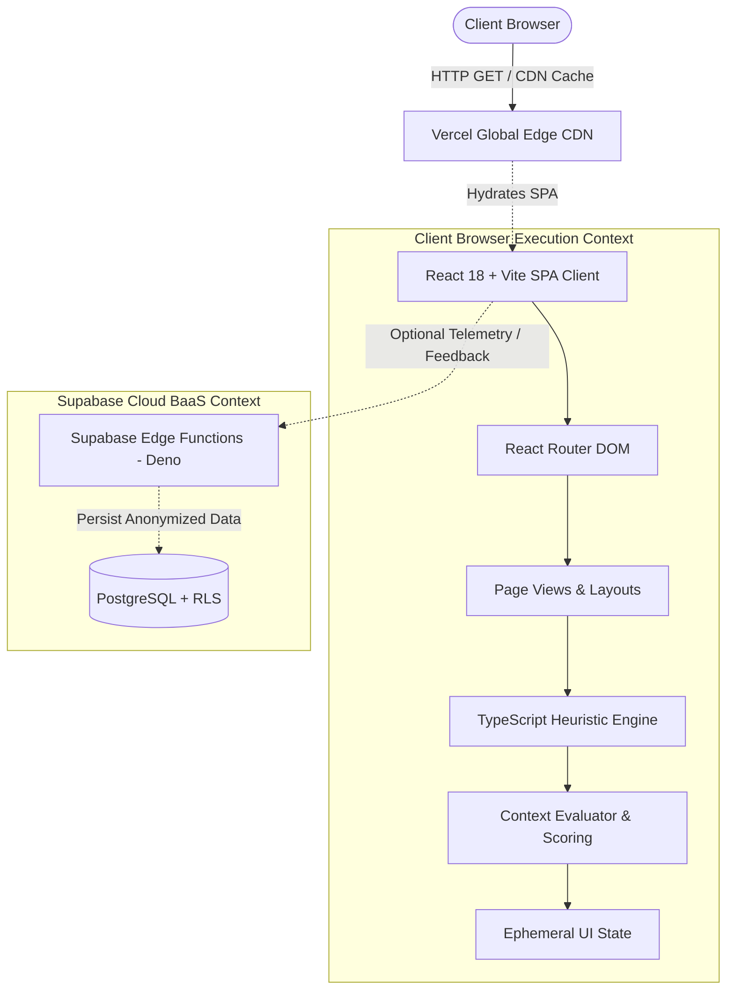

---

## 3. Architectural Goals and Principles

1. **Separation of Concerns:** Strict isolation between the Presentation Layer (React UI, Tailwind, shadcn/ui), the Domain Layer (pure TypeScript heuristic modules), and the Infrastructure Layer (Supabase clients, routing).
2. **Deterministic & Testable Domain Logic:** All rule evaluation, score calculation, deduplication, and evidence extraction logic must be pure functions ($f(\text{input}) \to \text{assessment}$). They must run and pass tests without browser DOM, browser network, or server dependencies.
3. **Defense in Depth & Safe Rendering:**
   - User inputs are treated as strictly untrusted text.
   - Text is never rendered into the DOM using raw HTML injection (`dangerouslySetInnerHTML`).
   - Zero automated outbound network resolution or crawling of submitted URLs.
4. **Data Minimization & Ephemeral State:** Never store what is not strictly needed. User submissions are held in volatile component memory and wiped on navigation or page reset.
5. **Progressive Enhancement & Accessible Interactions:** Adherence to WCAG 2.1 AA standards; keyboard-navigable interfaces, high color-contrast ratios, and fallback behaviors for `prefers-reduced-motion`.
6. **No Premature Abstraction:** Single, modular repository architecture without unnecessary microservices, monorepo tooling, or redundant state-management wrappers.

---

## 4. System Context

The system context diagram illustrates CyberShield's boundary, actors, internal layers, and external relationships.

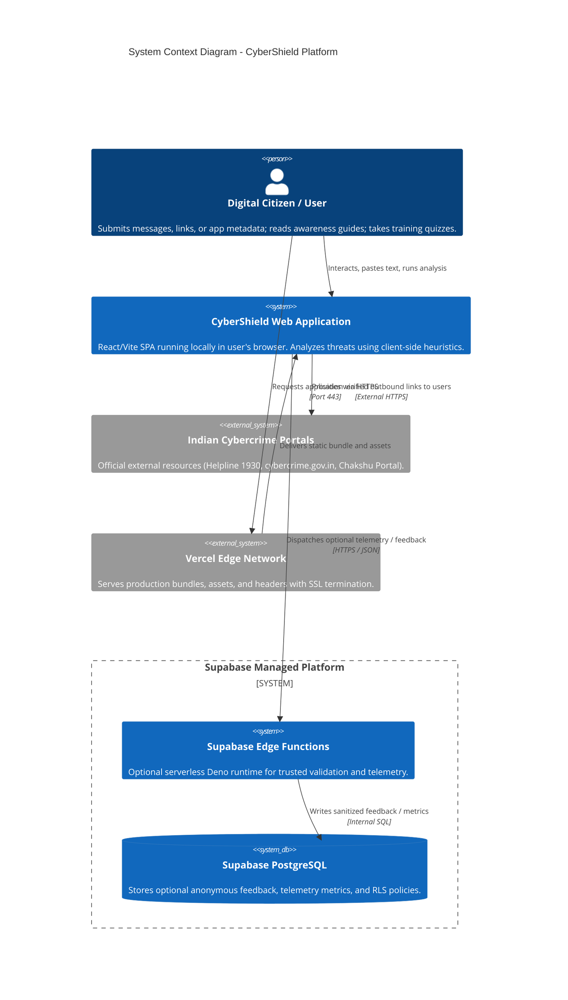

---

## 5. High-Level Architecture

CyberShield comprises eight distinct structural layers:

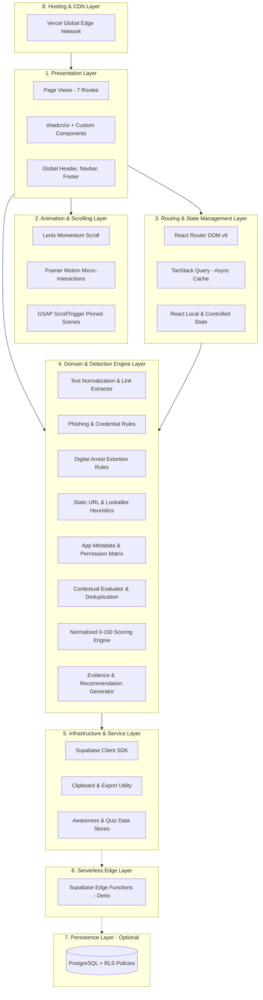

---

## 6. Technology Architecture

### 6.1 Frontend Core & Tooling
- **React (v18.x):** Core component-driven view engine. Employs functional components, React Hooks (`useMemo`, `useCallback`, `useReducer`), and strict component encapsulation.
- **Vite (v5.x / Latest):** Next-generation ESM development server and bundler. Handles lightning-fast HMR and generates optimized Rollup production builds with granular chunk splitting.
- **TypeScript (v5.x):** Strictly typed codebase (`strict: true`, `noImplicitAny: true`). Provides compile-time structural typing for detection results, rule definitions, and UI props.

### 6.2 Routing & Server State
- **React Router (v6.x):** Declarative client-side routing across 7 distinct routes. Manages navigation transitions, URL parameter parsing, and 404 error boundaries.
- **TanStack Query (v5.x):** Dedicated asynchronous state manager. In CyberShield, TanStack Query is used selectively for Edge Function communication and dynamic feedback submissions, providing automatic caching, error handling, and background refetching.

### 6.3 Styling & UI Component Library
- **Tailwind CSS (v3.x):** Utility-first CSS framework providing a curated design system (colors, spacing, typography, dark mode tokens) embedded in components.
- **shadcn/ui:** Accessible, unstyled UI primitives built on Radix UI, styled with Tailwind CSS. Included directly in source (`src/components/ui/`), allowing complete internal styling control without external black-box library locks.

### 6.4 Motion & Scroll Experience
- **Lenis:** Smooth, momentum-based window scrolling library. Replaces default browser scroll mechanics with high-performance virtualized physics.
- **Framer Motion:** Declarative React motion library. Used for UI micro-interactions, layout morphs, accordion expands, gauge progress animations, and route transition fades.
- **GSAP (with ScrollTrigger):** Used strictly for advanced, scroll-driven visual narratives (e.g., sticky section pinning in the educational Threat Awareness Center and Hero visual reveals).

### 6.5 Backend-as-a-Service (Supabase)
- **Supabase PostgreSQL:** Scalable relational database. Used strictly for data requiring genuine persistence (optional anonymous user feedback and error telemetry). Core analysis does **not** persist data.
- **Supabase Auto-generated REST APIs:** Provides secure PostgREST endpoints governed by database Row Level Security.
- **Supabase Edge Functions:** Serverless Deno functions deployed globally at Supabase edge nodes for trusted payload validation or rate-limited feedback ingestion.
- **Excluded Features:** Supabase Auth, Storage, and Realtime are excluded from the MVP scope as they are not justified by the requirements.

### 6.6 Hosting & Deployment
- **Vercel:** Global serverless edge platform. Manages production builds, automated preview branch deployments, Edge Network CDN distribution, and HTTP security header injection (`vercel.json`).

---

## 7. Frontend Architecture

### 7.1 Recommended Directory Structure

```
cyber-shield/
├── public/
│   ├── favicon.ico
│   └── robots.txt
├── src/
│   ├── app/                        # App root providers, router configuration, layout wrappers
│   │   ├── App.tsx                 # Main application component & provider tree
│   │   ├── routes.tsx              # React Router route registry
│   │   └── providers.tsx           # TanStack Query, Theme, and Lenis providers
│   ├── components/                 # Component tree
│   │   ├── ui/                     # shadcn/ui primitives (button, card, dialog, tabs, etc.)
│   │   ├── layout/                 # Navbar, Header, Footer, Container, PageWrapper
│   │   └── feedback/               # ErrorBoundary, AlertBanner, LoadingSpinner
│   ├── features/                   # Domain-driven feature modules
│   │   ├── analysis/               # Threat analysis forms, results display, evidence list
│   │   │   ├── components/         # AnalysisForm, ScoreGauge, EvidenceCard, ActionList
│   │   │   ├── hooks/              # useThreatAnalysis, useSampleLoader
│   │   │   └── types/              # Form input types, view state models
│   │   ├── awareness/              # Knowledge center, article reader, category filter
│   │   │   ├── components/         # ArticleGrid, ArticleCard, SearchFilter
│   │   │   └── data/               # Static awareness articles markdown/JSON
│   │   ├── safety/                 # Safety checklist & Indian emergency contacts
│   │   │   └── components/         # IncidentChecklist, HelplineCard, DirectoryGrid
│   │   └── training/               # Scam simulations & knowledge assessment quiz
│   │       ├── components/         # SimulationCard, HotspotPicker, QuizStepper, ScoreSummary
│   │       ├── hooks/              # useQuizSession, useSimulationEngine
│   │       └── data/               # Simulation scenarios & 10-question quiz bank
│   ├── engine/                     # PURE DOMAIN LOGIC: Detection & Risk Engine
│   │   ├── preprocessor/           # Text sanitization, homoglyph replacement, URL extractor
│   │   ├── rules/                  # Modular threat detection rules
│   │   │   ├── phishing.ts         # Credential, OTP, urgency, and KYC rules
│   │   │   ├── digital-arrest.ts   # Legal intimidation, agency impersonation, isolation
│   │   │   ├── url.ts              # Structure, IP-host, TLD, lookalike heuristics
│   │   │   └── app-metadata.ts     # Permission hazards & sideloading rules
│   │   ├── context/                # Contextual modulation & deduplication logic
│   │   ├── scoring/                # 0-100 normalization & 4-tier classification
│   │   ├── explainability/         # Evidence formatter, recommendation engine, limitations
│   │   ├── types.ts                # TypeScript engine contracts (Rule, Finding, Result)
│   │   └── index.ts                # Primary orchestrator facade (runThreatAnalysis)
│   ├── hooks/                      # Global cross-feature React hooks
│   │   ├── useLenisScroll.ts       # Lenis smooth scroll initializer & cleanup
│   │   └── useCopyToClipboard.ts   # Safe clipboard copy utility
│   ├── lib/                        # Infrastructure client configurations
│   │   ├── supabase.ts             # Initialized Supabase client instance
│   │   └── utils.ts                # Class merging (clsx / tailwind-merge)
│   ├── styles/                     # Global styles
│   │   └── globals.css             # Tailwind base layers, CSS variables, Lenis styles
│   ├── types/                      # Global application-wide type declarations
│   └── main.tsx                    # Vite entry point
├── tests/                          # Automated test suites
│   ├── unit/                       # Rule and scoring unit tests (Vitest)
│   ├── benchmark/                  # 75 labeled sample detection test corpus
│   └── components/                 # Component render and accessibility tests
├── index.html                      # HTML entry template
├── package.json                    # Project dependencies and npm scripts
├── tsconfig.json                   # Strict TypeScript compiler options
├── tailwind.config.js              # Tailwind tokens and animation configurations
├── vite.config.ts                  # Vite build, alias, and optimization configurations
└── vercel.json                     # Vercel deployment & security headers configuration
```

### 7.2 Module Dependency Flow
To maintain loose coupling and avoid circular references, the codebase enforces a strict unidirectional dependency hierarchy:

```
[UI Components / Pages]
        │
        ▼
[Feature Hooks & View Models]
        │
        ▼
[Engine Orchestrator (engine/index.ts)]
        │
        ▼
[Rule Modules / Preprocessor / Scoring]
        │
        ▼
[Engine Types & Utilities (engine/types.ts)]
```

*Rule:* Modules within `src/engine/` must never import from `src/components/`, `src/features/`, or external browser state.

---

## 8. Routing Architecture

### 8.1 Route Table & Page Specifications
React Router manages client-side routing across 7 distinct routes.

| Route Path | Page Name | Primary Component | Responsibility |
| :--- | :--- | :--- | :--- |
| `/` | Home / Dashboard | `HomePage` | Hero section, threat overview, rapid triage preview, high-priority alert banners. |
| `/analyze` | Analyze Threats | `AnalyzePage` | Form accepting messages, standalone URLs, or app metadata with sample loader. |
| `/analyze/results`| Analysis Results | `ResultsPage` | Displays 0–100 score gauge, classification, findings accordion, and safety steps. |
| `/awareness` | Threat Awareness | `AwarenessPage` | Searchable, category-filtered cybersecurity educational articles. |
| `/safety-guide` | Safety & Incident | `SafetyGuidePage` | Emergency checklist and verified Indian reporting resources (1930 Helpline). |
| `/training` | Training & Quizzes | `TrainingPage` | Interactive fictional scam simulations and 10-question knowledge quiz. |
| `/about` | About & Privacy | `AboutPage` | Methodology breakdown, scoring transparency, privacy manifesto, limitations. |
| `*` | 404 Not Found | `NotFoundPage` | Friendly error recovery view guiding users back to the Dashboard. |

### 8.2 Layout & Error Boundaries
- **Global Layout Wrapper:** `AppLayout` encloses all routes, providing a persistent Header (with 1930 Helpline emergency badge), navigation links, and a standardized Footer.
- **Route Error Boundary:** Each primary route is wrapped in an `ErrorBoundary` that catches rendering anomalies and displays an accessible recovery interface without crashing the entire SPA.

---

## 9. State Management and Data Fetching

### 9.1 State Architecture Strategy
CyberShield clearly separates **Ephemeral UI State** from **Asynchronous Server State**:

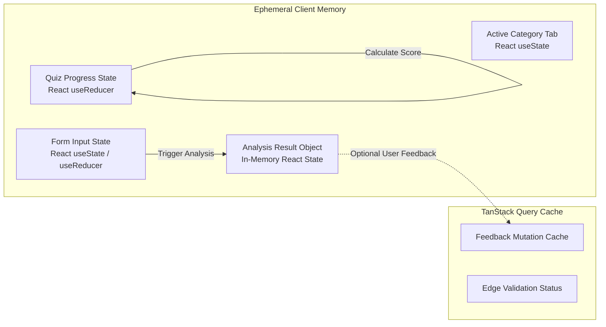

### 9.2 TanStack Query Configuration
- **Stale Time:** Static data is configured with `staleTime: Infinity` (since awareness and simulation data are bundled locally).
- **Mutations:** Used exclusively for dispatching non-blocking telemetry or user feedback to Supabase Edge Functions:
  ```typescript
  // Example Mutation Pattern in src/features/analysis/hooks/useSubmitFeedback.ts
  export const useSubmitFeedback = () => {
    return useMutation({
      mutationFn: async (payload: FeedbackPayload) => {
        const { data, error } = await supabase.from('analysis_feedback').insert([payload]);
        if (error) throw error;
        return data;
      },
      retry: 1, // Minimize retry spam on network failures
    });
  };
  ```

---

## 10. Domain Logic and Business-Logic Architecture

### 10.1 Engine Pipeline Architecture
The threat detection engine is organized as a composite pipeline executing sequentially:

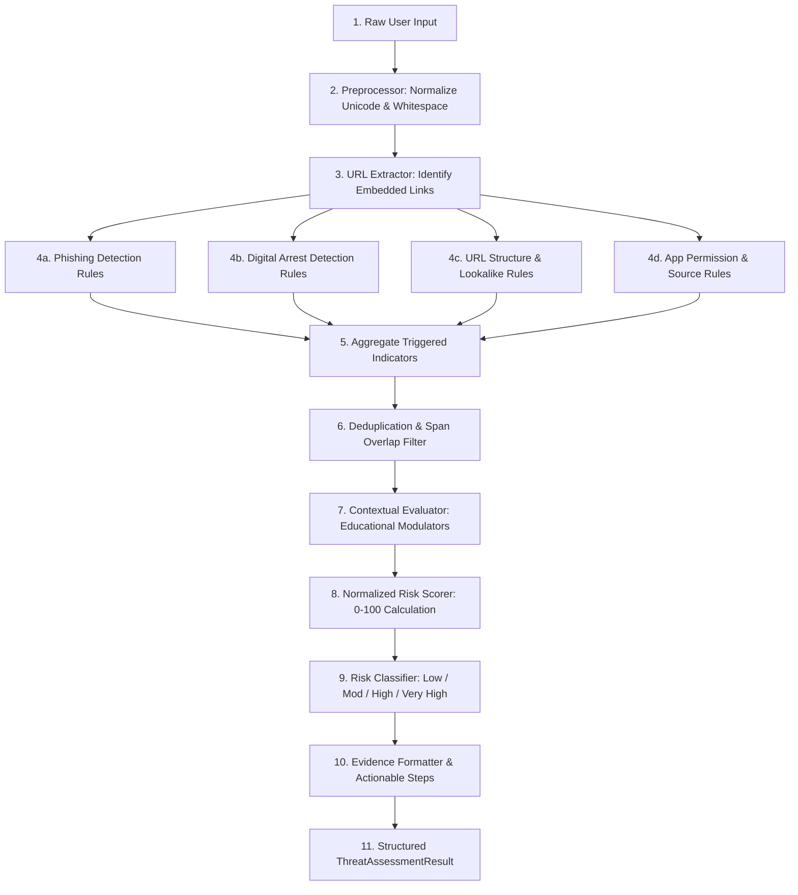

### 10.2 Mathematical Scoring Model
The final score $S \in [0, 100]$ is computed deterministically:
$$S = \min\left(100, \max\left(0, \text{round}\left(\left(\sum_{i=1}^{n} w_i\right) \times C_{\text{context}}\right)\right)\right)$$

Where:
- $w_i \in [5, 40]$ represents the static weight assigned to the $i$-th deduplicated triggered rule.
- $C_{\text{context}} \in [0.4, 1.2]$ is the contextual modifier:
  - $C_{\text{context}} = 0.4$ if explicit educational or warning markers are detected (`/(beware of|alert:|caution|scam alert)/i`).
  - $C_{\text{context}} = 1.15$ if compounding indicators (e.g., Digital Arrest Coercion + Urgent Escrow Demands) trigger simultaneously.
  - $C_{\text{context}} = 1.0$ default baseline.

---

## 11. Backend and Service Architecture

### 11.1 Supabase Integration Model
CyberShield eliminates the need for an express Node.js server by utilizing Supabase serverless capabilities:
1. **Edge Functions (Deno Runtime):** Used when server-side execution is needed.
   - Example: Rate-limiting public submissions or validating input strings before persisting feedback.
2. **PostgreSQL Database:** Hosts optional feedback and aggregate metrics tables with Row Level Security.
3. **No Direct Secret Exposure:** The frontend client initializes `createClient(VITE_SUPABASE_URL, VITE_SUPABASE_ANON_KEY)`. The Supabase Service Role key is strictly reserved for CI/CD or backend migrations and is never injected into Vite bundles.

---

## 12. Database Architecture

### 12.1 Persistence Strategy
**Core Threat Analysis is 100% Stateless.**  
No table exists to record submitted messages, URLs, or analysis scores.

### 12.2 Relational Schema (Optional Feedback & Telemetry)
If user feedback or anonymous aggregate usage telemetry is activated, the following PostgreSQL schema is deployed:

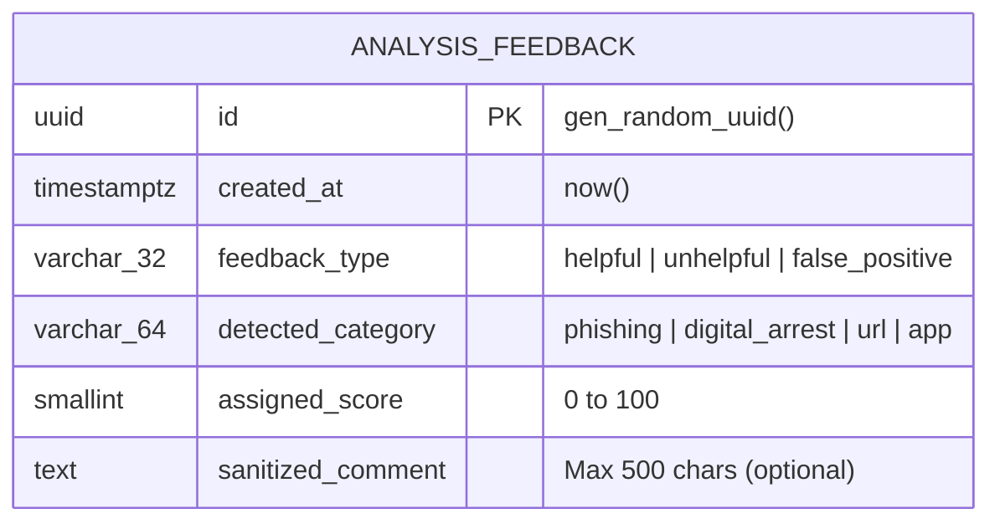

#### SQL Definition & Row Level Security:
```sql
-- 1. Create table
CREATE TABLE public.analysis_feedback (
    id UUID PRIMARY KEY DEFAULT gen_random_uuid(),
    created_at TIMESTAMPTZ NOT NULL DEFAULT now(),
    feedback_type VARCHAR(32) NOT NULL CHECK (feedback_type IN ('helpful', 'unhelpful', 'false_positive')),
    detected_category VARCHAR(64) NOT NULL,
    assigned_score SMALLINT NOT NULL CHECK (assigned_score >= 0 AND assigned_score <= 100),
    sanitized_comment TEXT CHECK (length(sanitized_comment) <= 500)
);

-- 2. Enable RLS
ALTER TABLE public.analysis_feedback ENABLE ROW LEVEL SECURITY;

-- 3. Policy: Anonymous users can insert feedback
CREATE POLICY "Allow anonymous insert feedback" 
ON public.analysis_feedback 
FOR INSERT 
TO anon 
WITH CHECK (true);

-- 4. Policy: Disallow public select (Only service role can read feedback)
CREATE POLICY "Deny public select feedback" 
ON public.analysis_feedback 
FOR SELECT 
TO anon 
USING (false);
```

---

## 13. API and Communication Architecture

### 13.1 Communication Boundaries

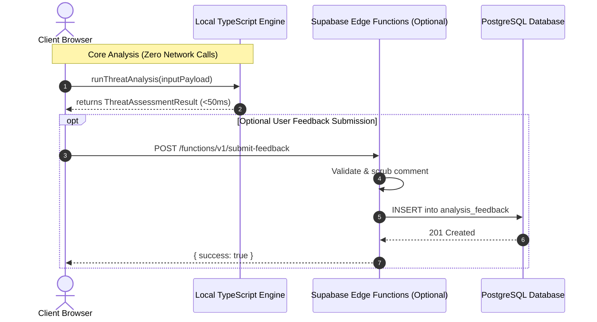

---

## 14. Data Flow Architecture

### 14.1 End-to-End Threat Analysis Lifecycle
1. **Input Ingestion:** User inputs raw text, a standalone URL, or application parameters via `AnalysisForm`.
2. **Frontend Validation:** Form validates constraints ($1 \le \text{length} \le 5,000$ chars; valid URL structure) before touching the engine.
3. **Execution in Isolated Memory:** The engine parses and normalizes the input in browser RAM.
4. **Heuristic Evaluation:** Modules run synchronously against regex matrices and structural rules.
5. **Score & Evidence Assembly:** `ThreatAssessmentResult` is constructed, containing findings, score, and recommendations.
6. **Presentation Rendering:** React components render the score gauge, findings accordion, and action list.
7. **Purge / Reset:** Upon clicking "Analyze Another Threat" or closing the browser tab, the memory is released by garbage collection.

---

## 15. Authentication and Authorization Architecture

### 15.1 MVP Scope Decision: Authentication Excluded
- **No User Registration:** CyberShield requires no account creation, passwords, or OAuth tokens. This eliminates credential theft risks and minimizes barrier to entry for users under duress (e.g., victims of active digital arrest scams).
- **Future Extensibility:** If user authentication is introduced in future versions, it will leverage **Supabase Auth** with RLS policies mapping user UUIDs to private threat triage logs, maintaining strict user isolation.

---

## 16. Security Architecture

### 16.1 Threat Boundaries & Mitigation Strategies

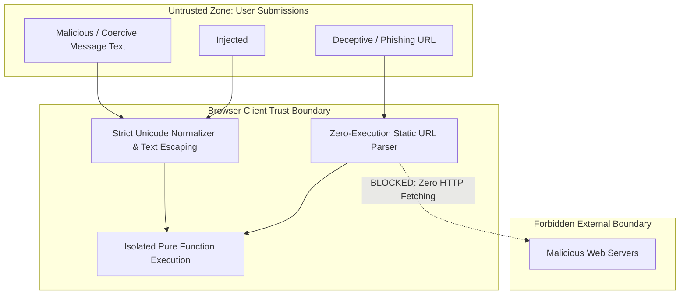

### 16.2 Key Security Controls
1. **XSS Mitigation:** React's native string interpolation escapes all dynamic content. Raw HTML rendering is strictly prohibited.
2. **SSRF & Malicious Payload Mitigation:** The application enforces a strict architectural rule: **CyberShield never resolves, fetches, pings, or previews user-submitted URLs.** URL analysis is performed purely on the syntactic structure (TLDs, subdomains, port numbers, IP formats).
3. **Content Security Policy (CSP):** Deployed via `vercel.json` HTTP headers:
   ```json
   {
     "key": "Content-Security-Policy",
     "value": "default-src 'self'; script-src 'self'; style-src 'self' 'unsafe-inline'; img-src 'self' data:; connect-src 'self' https://*.supabase.co; font-src 'self' https://fonts.gstatic.com;"
   }
   ```

---

## 17. Privacy and Data Lifecycle Architecture

1. **Zero Text Retention:** Raw submitted messages and URLs are never written to disk, databases, or third-party analytical tools.
2. **Log Scrubbing:** Client error reporting (if configured) must redact phone numbers, OTP tokens, email addresses, and query parameters matching `/([0-9]{4,8}|otp|password|token)/i`.
3. **No Third-Party Trackers:** No advertising trackers, social media pixels, or invasive session-replay tools (e.g., Hotjar) are permitted in the client bundle.

---

## 18. Error Handling and Observability

### 18.1 Multi-Tier Error Strategy
- **Layer 1: Input Validation Errors:** Displayed inline below form fields using `shadcn/ui` alert styles.
- **Layer 2: Engine Processing Errors:** Gracefully caught in a `try...catch` wrapper inside the `useThreatAnalysis` hook, returning an `isInconclusive: true` assessment with a clear user prompt.
- **Layer 3: Network & Edge Errors:** TanStack Query handles network timeout and retries, falling back to local analysis when Supabase functions are unreachable.
- **Layer 4: Component Rendering Failures:** Handled by React `ErrorBoundary` class components with a "Reset Application" button.

---

## 19. Animation and Rendering Architecture

### 19.1 Division of Animation Responsibilities
To prevent performance degradation, layout thrashing, and library conflicts, animation tools are allocated strict, non-overlapping duties:

| Technology | Architectural Scope | Permitted Usage | Prohibited Usage |
| :--- | :--- | :--- | :--- |
| **Lenis** | Global Window Scrolling | Smooth, momentum-based scrolling across all page routes. | Component-level scrolling or inner drawer scrolling. |
| **Framer Motion** | Component Micro-Interactions | Button hover states, tab-switching fades, accordion collapse/expand, score gauge animations. | Window-level scroll hijacking or timeline scrubbing. |
| **GSAP & ScrollTrigger**| Narrative Scroll Pinning | Long-form storytelling in `/awareness` and interactive Hero reveals. | Simple UI hover states or micro-animations. |

### 19.2 Accessibility (Reduced Motion)
All animation implementations must query `window.matchMedia('(prefers-reduced-motion: reduce)')`. When active:
- Lenis scrolling is disabled.
- Framer Motion transitions are set to `duration: 0`.
- GSAP animations immediately snap to their final state.

---

## 20. Performance and Scalability Architecture

1. **Code Splitting & Lazy Loading:** Non-critical routes (`/awareness`, `/safety-guide`, `/training`, `/about`) are dynamically loaded via `React.lazy()` and `Suspense`:
   ```typescript
   const AwarenessPage = React.lazy(() => import('@/features/awareness/pages/AwarenessPage'));
   const TrainingPage = React.lazy(() => import('@/features/training/pages/TrainingPage'));
   ```
2. **Bundle Budget:** Maximum initial JS bundle size: $\le 250\text{ KB}$ gzipped.
3. **Execution Latency:** Pure TypeScript heuristic analysis executes in $\le 50\text{ ms}$ for a 5,000-character payload.

---

## 21. Testing Architecture

### 21.1 Testing Hierarchy & Boundaries

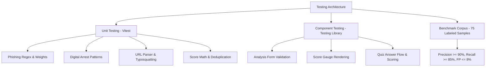

- **Domain Logic Isolation:** Tests in `tests/unit/` run against pure functions in `src/engine/` without mounting DOM or mocking browser windows.
- **Benchmark Corpus:** Evaluates false-positive and false-negative rates against 50 real-world malicious samples and 25 benign controls.

---

## 22. Deployment Architecture

### 22.1 CI/CD & Vercel Pipeline

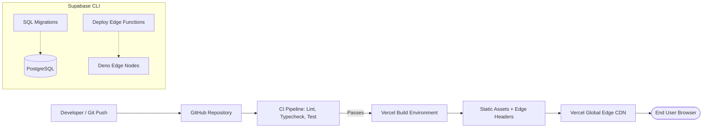

---

## 23. Environment and Configuration Architecture

### 23.1 Configuration Matrix

| Variable | Environment | Scope | Description |
| :--- | :--- | :--- | :--- |
| `VITE_APP_ENV` | Dev / Staging / Prod | Public (Client) | Active application environment. |
| `VITE_SUPABASE_URL` | Dev / Staging / Prod | Public (Client) | HTTPS endpoint for Supabase BaaS. |
| `VITE_SUPABASE_ANON_KEY` | Dev / Staging / Prod | Public (Client) | Anonymous public key with RLS enforcement. |

*Security Guarantee:* The `SUPABASE_SERVICE_ROLE_KEY` is strictly prohibited from Vite configuration and client-side builds.

---

## 24. Architectural Decisions and Trade-Offs (ADRs)

### ADR-001: Client-Side Heuristic Engine vs. Remote Server Evaluation
- **Context:** Deciding whether detection heuristics should execute in the user's browser or on a remote server.
- **Decision:** Execute heuristics **locally in the browser** using modular TypeScript.
- **Rationale:** Guarantees absolute privacy (user messages never leave the device), eliminates backend latency, ensures offline capability, and significantly reduces cloud operational costs.
- **Trade-off:** Heuristic rules are publicly visible in client JS bundles. This is acceptable as CyberShield is an open, educational transparency tool.

### ADR-002: Zero-Persistence Architecture for Core Threat Analysis
- **Context:** Deciding whether to persist user submissions in Supabase PostgreSQL to build analysis history.
- **Decision:** **Do not persist submissions.** Process all analysis ephemerally in client memory.
- **Rationale:** Drastically reduces legal and privacy liabilities regarding sensitive user credentials or personal communications.
- **Trade-off:** Users cannot access cloud history across devices (an explicit exclusion confirmed in MVP scope).

### ADR-003: Static URL Parsing vs. Live Network Fetching
- **Context:** Deciding whether to ping or crawl submitted URLs to check HTTP status and response headers.
- **Decision:** **Strictly prohibit live URL fetching.** Analyze only the static structure, hostnames, and syntax.
- **Rationale:** Prevents Server-Side Request Forgery (SSRF), protects users from triggering malicious payloads, and avoids IP blacklisting.
- **Trade-off:** Cannot inspect dynamic web page content or cloaked redirect chains. This limitation is explicitly disclosed in the UI.

### ADR-004: Coordinated Tri-Library Animation Architecture
- **Context:** Avoiding conflicts between Lenis, Framer Motion, and GSAP ScrollTrigger.
- **Decision:** Restrict each library to a mutually exclusive domain: Lenis for global scroll, Framer Motion for component states, GSAP for long-form scroll pinning.
- **Rationale:** Maximizes visual engagement while preventing layout thrashing and animation stutter.
- **Trade-off:** Modest increase in initial bundle size (~50 KB gzipped total for all three libraries).

---

## 25. Failure Scenarios and Recovery

| Failure Scenario | Architectural Layer | System Recovery Behavior |
| :--- | :--- | :--- |
| **Supabase BaaS Outage** | Infrastructure Layer | Application continues uninterrupted; core analysis is 100% functional; feedback submission fails gracefully with an alert. |
| **Malformed User Input** | Preprocessor Layer | Caught during regex normalization; returns `isInconclusive: true` with a request for clearer text. |
| **Client Script Crash** | Presentation Layer | Caught by React `ErrorBoundary`; renders a fallback UI allowing the user to reset without page reload. |
| **Slow Mobile Connection**| Network Layer | Core bundle loads incrementally via code-splitting; static heuristics run instantly once loaded. |

---

## 26. Recommended Project Structure

*(See detailed directory layout in [Section 7.1](#71-recommended-directory-structure). All modules strictly observe the unidirectional dependency hierarchy).*

---

## 27. Architectural Risks and Open Questions

### 27.1 Technical & Security Risks
| Risk ID | Description | Severity | Mitigation |
| :--- | :--- | :--- | :--- |
| **AR-001** | Rule Evasion via Obfuscation (e.g., zero-width spaces, leetspeak) | High | Implement comprehensive Unicode stripping and leetspeak substitution in the preprocessor. |
| **AR-002** | Bundle Size Inflation from Animation Libraries | Medium | Utilize tree-shaking on GSAP plugins and lazy-load Framer Motion features using `LazyMotion`. |
| **AR-003** | User Misinterprets "Low Risk" as Absolute Safety | High | Display mandatory disclaimers and limitations disclosure on every analysis result. |

### 27.2 Open Questions
1. *Should Supabase Edge Functions be implemented in Phase 1 or deferred to Phase 4?*  
   **Recommendation:** Scaffolding in Phase 1 with placeholder stubs, full integration during Phase 4 when analysis forms are connected.
2. *Should simulation progress be cached in `localStorage`?*  
   **Recommendation:** Yes, as an un-synced, privacy-safe local convenience for the user.

---

## 28. Architecture Implementation Sequence

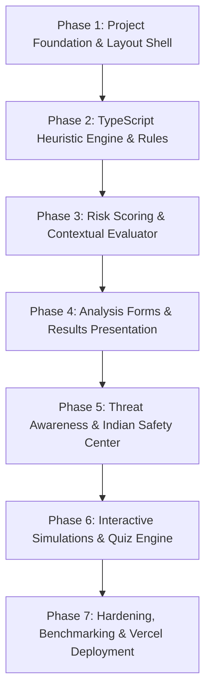

- **Phase 1: Foundation:** Scaffold Vite + React + TypeScript, Tailwind CSS, shadcn/ui primitives, React Router (7 routes), Lenis setup.
- **Phase 2: Detection Engine:** Build preprocessor, URL extractor, and modular rule dictionaries (`phishing.ts`, `digital-arrest.ts`, `url.ts`, `app-metadata.ts`).
- **Phase 3: Scoring & Explainability:** Implement the 0–100 scoring model, contextual modulation, deduplication, and recommendation engines.
- **Phase 4: Analysis Interface:** Connect the UI forms to the local engine, render score gauges, findings lists, and sample scenarios.
- **Phase 5: Awareness & Escalation:** Populate educational articles, search filtering, and the Indian cybercrime escalation directory.
- **Phase 6: Training & Quizzes:** Build interactive scam scenario cards, hotspot selectors, and the 10-question quiz engine.
- **Phase 7: Hardening & Deployment:** Run benchmark corpus tests, conduct accessibility audits, configure Vercel CSP headers, and deploy.

---

## 29. Architecture Validation Checklist

- [x] **Architectural Style:** Documented as an explainable, client-first SPA with serverless BaaS extensions.
- [x] **Technology Alignment:** Exactly matches the approved stack (React, Vite, TS, React Router, TanStack Query, Tailwind, shadcn/ui, Lenis, Framer Motion, GSAP, Supabase, Vercel).
- [x] **Separation of Concerns:** Clear demarcation between Presentation, Domain Engine, and Infrastructure layers.
- [x] **Data Privacy & Ephemeral State:** Zero database persistence for core analysis; raw text is processed in-memory and discarded.
- [x] **Security Constraints:** Prohibits automated URL fetching (SSRF prevention); mandates safe text rendering (XSS prevention); secures Supabase via RLS.
- [x] **Animation Strategy:** Lenis (scroll), Framer Motion (components), GSAP (scenes) clearly divided with reduced-motion support.
- [x] **Testability:** Pure TypeScript engine modules decoupled from the DOM for 100% unit testability.
- [x] **Traceability:** Fully aligned with [`PRD.md`](file:///c:/Users/Bhuvan%20A/OneDrive/Desktop/project/projectt/PRD.md) requirements, workflows, and MVP scope.
