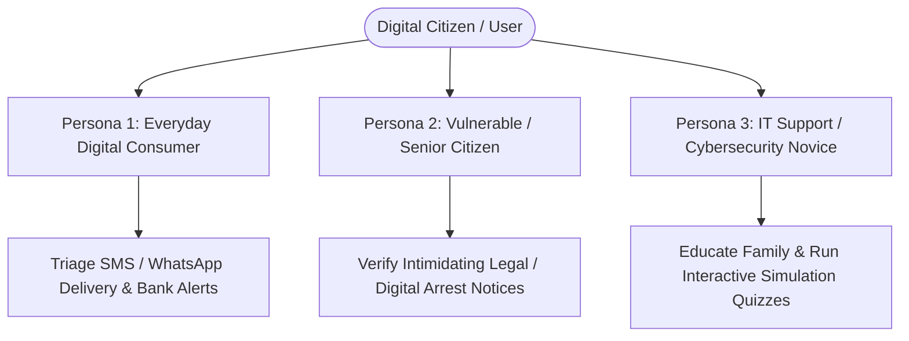
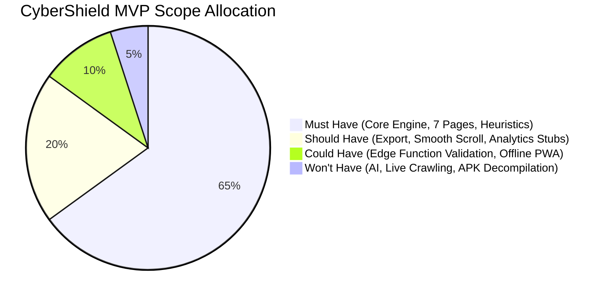
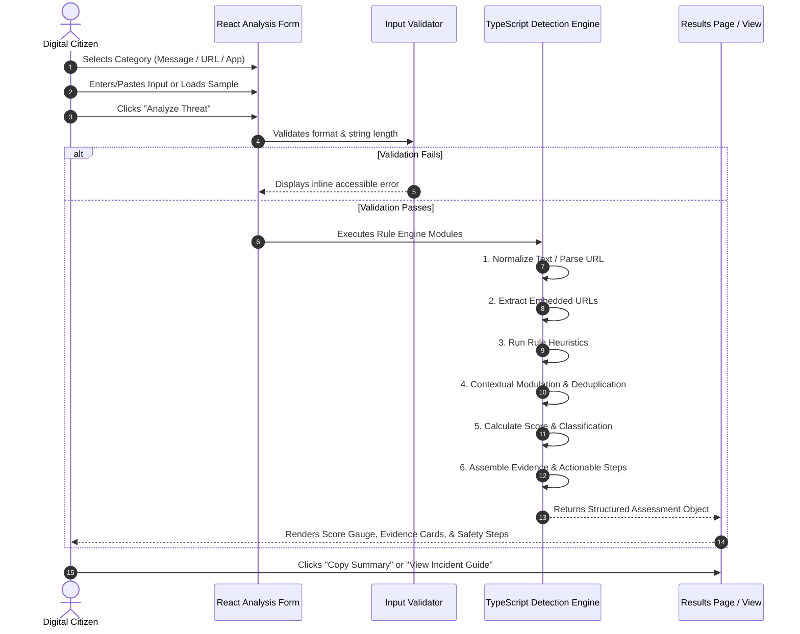
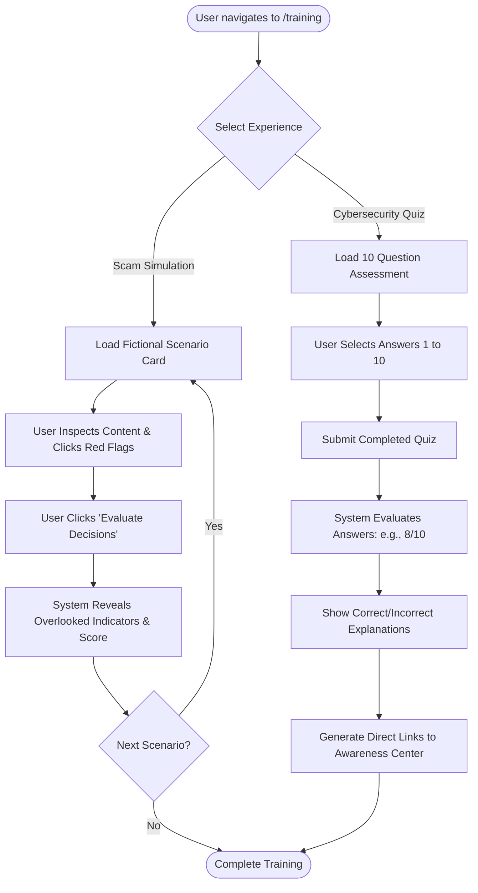
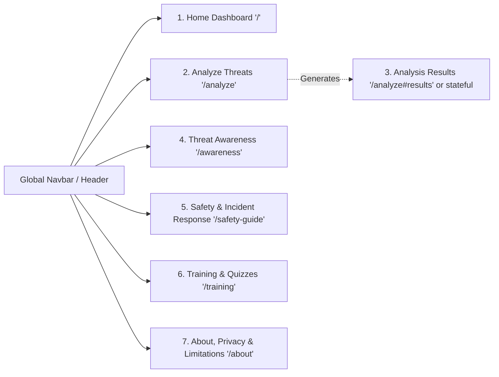
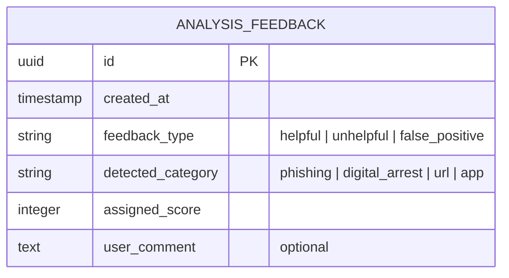
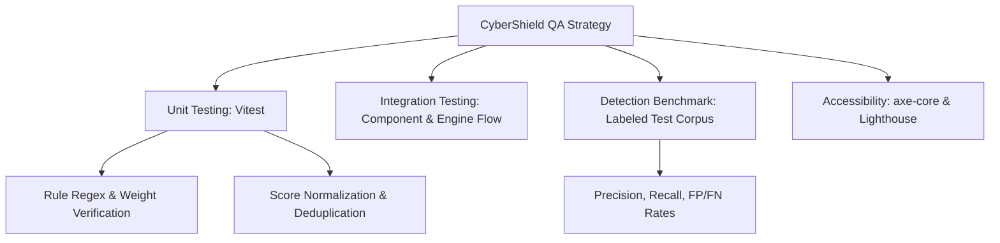
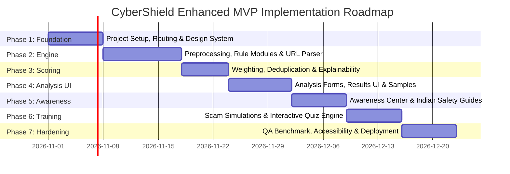

# Product Requirements Document (PRD) — CyberShield

**Document Identifier:** PRD-CYBER-SHIELD-001  
**Product Name:** CyberShield (Enhanced MVP)  
**Product Version:** 1.0.0-MVP  
**Document Status:** Approved for Implementation  
**Target Release Date:** Q4 2026 / Phase 1–7 Milestone Delivery  
**Authors & Stakeholders:** Senior Product Manager, Software Architect, Lead Cybersecurity Engineer, Technical Business Analyst  

---

## 1. Document Overview

### 1.1 Purpose
This Product Requirements Document (PRD) serves as the definitive, implementation-ready product and technical specification for **CyberShield**. It specifies all user requirements, system architectures, functional specifications, domain logic rules, UI/UX workflows, non-functional standards, security boundaries, and validation criteria. It is designed to guide software engineers and autonomous AI coding agents through the phased implementation of CyberShield without requiring architectural guesswork.

### 1.2 Intended Audience
- **Autonomous AI Coding Agents & Software Engineers:** Primary engineering specification for code generation, module design, and automated testing.
- **Cybersecurity & QA Engineers:** Specification for threat rule verification, test case evaluation (false-positive/false-negative rates), and security posture auditing.
- **Product Owners & Technical Stakeholders:** Baseline for scope verification, feature acceptance, and roadmap management.

### 1.3 Scope and Designation
This document governs the **CyberShield Enhanced MVP**. It covers the end-to-end implementation of an explainable, rule-based cybersecurity awareness and threat assessment web platform. It establishes the client-side detection engine, optional Supabase Edge Function boundaries, static cybersecurity curriculum, interactive simulation/quiz engines, and verified incident-response workflows tailored to consumer protection (specifically incorporating Indian cybercrime escalation resources).

### 1.4 Terminology & Acronyms
| Term / Acronym | Definition |
| :--- | :--- |
| **BaaS** | Backend-as-a-Service (specifically Supabase PostgreSQL and Edge Functions). |
| **Digital Arrest Scam** | A prevalent cyber-extortion scheme where attackers impersonate law enforcement/customs/judiciary over video/voice/messaging, falsely alleging legal violations and demanding illicit financial settlements. |
| **Edge Function** | Serverless function running on Deno at the network edge via Supabase, executing trusted operations without a full Node.js server. |
| **FR** | Functional Requirement. |
| **Heuristic Detection** | Rule-based analysis that evaluates static patterns, syntax, keywords, and structural metadata without executing dynamic malware payloads. |
| **Lookalike Domain** | A deceptive domain using homoglyphs, typosquatting, hyphenation, or spoofed brand subdomains to deceive users. |
| **NFR** | Non-Functional Requirement. |
| **OTP** | One-Time Password used for multi-factor authentication or transaction verification. |
| **PRD** | Product Requirements Document. |
| **RLS** | Row Level Security (PostgreSQL security policy enforced in Supabase). |
| **TC** | Test Case. |
| **TLD** | Top-Level Domain (e.g., `.com`, `.org`, `.xyz`, `.top`). |

---

## 2. Executive Summary

CyberShield is an explainable, client-first cybersecurity awareness and threat assessment web platform. In an era where digital deception—specifically multi-channel phishing, deceptive URL redirection, mobile sideloading coercion, and high-pressure "digital arrest" extortion—targets ordinary citizens, users lack accessible, rapid, and transparent tooling to triage suspicious communications.

CyberShield provides an immediate, privacy-preserving threat analysis engine that accepts:
1. Suspicious text messages (SMS, WhatsApp, Telegram, email snippets).
2. Standalone or extracted URLs.
3. Mobile application metadata (package names, claimed publishers, permissions, install sources).

Operating strictly on a **"Submit → Analyze → Score → Explain → Recommend → Educate"** pipeline, CyberShield evaluates inputs against transparent, deterministic, rule-based heuristics. It outputs a normalized 0–100 Risk Score, categorical risk levels (Low, Moderate, High, Very High), itemized evidence excerpts, contextual explanations, and tailored safety recommendations. Complementing this diagnostic capability, CyberShield provides an educational Threat Awareness Center, verified Indian cybercrime reporting guides (e.g., 1930 National Cyber Crime Helpline, Chakshu Portal), and an interactive Cybersecurity Training hub featuring realistic scam simulations and scored knowledge assessments.

The product is built on a modern, responsive stack (React, Vite, TypeScript, Tailwind CSS, shadcn/ui, Lenis, Framer Motion, and GSAP ScrollTrigger) connected to Supabase for trusted edge execution where necessary, deployed globally on Vercel.

---

## 3. Problem Statement

### 3.1 The Problem
Consumer cyber threats have evolved beyond crude spam into highly orchestrated psychological coercion and deceptive infrastructure engineering. Ordinary digital citizens encounter three acute vulnerabilities daily:
1. **Psychological Extortion & "Digital Arrest" Scams:** Attackers impersonate regulatory or law enforcement bodies (CBI, ED, Police, Customs, FedEx, Telecom Regulatory Authorities) claiming illegal narcotics shipments, tax fraud, or arrest warrants, coercing victims into continuous video isolation and fund liquidation.
2. **Obfuscated Credential & OTP Theft:** Malicious SMS, WhatsApp, and email communications leverage urgent triggers (e.g., imminent bank account deactivation, utility cutoffs, fake lotteries) paired with typosquatted lookalike URLs to harvest credentials and OTPs.
3. **Deceptive Mobile Applications & Rogue Sideloading:** Threat actors coerce users into downloading unverified `.apk` packages outside official app marketplaces, requesting excessive device permissions (SMS reading, accessibility services, notification listeners) that enable financial compromise.

### 3.2 Affected Users & Market Reality
Users across varying digital literacy levels—from elderly citizens and non-technical consumers to small business operators—are bombarded by unsolicited messages. Existing commercial security suites are either enterprise-focused, prohibitively complex, locked behind paid subscriptions, or act as "black boxes" that block content without educating the victim on *why* a communication was dangerous.

### 3.3 The CyberShield Solution
CyberShield dismantles threat opacity through **explainable triage**:
- It does not require software installation or privileged device root access.
- It operates with zero mandatory registration or credential collection.
- It processes submissions transparently, presenting exact string excerpts and structural anomalies that triggered threat rules.
- It pairs every negative finding with proactive mitigation steps and direct links to authorized law enforcement reporting portals.

---

## 4. Product Vision and Objectives

### 4.1 Product Vision
To establish the benchmark consumer cybersecurity utility for proactive threat triage and digital hygiene education, empowering digital citizens to independently deconstruct deceptive communications through clear, evidence-based heuristics.

### 4.2 Primary Objective
Deliver a responsive, zero-friction, production-grade web application capable of analyzing messages, URLs, and mobile application metadata within 500 milliseconds, returning deterministic risk scores, human-readable explanations, and actionable incident-response guidance.

### 4.3 Supporting Objectives
1. **High Explainability:** Disclose 100% of the detection rules that contributed to a risk score, displaying exact substring matches and structural metadata findings.
2. **Privacy by Default:** Ensure zero retention of analyzed message payloads, tokens, or personal identifiers in persistence layers during standard analysis.
3. **Localized Escalation:** Provide accurate, verified reporting procedures tailored to the Indian cyber ecosystem (Helpline 1930, National Cyber Crime Reporting Portal `cybercrime.gov.in`, Sanchar Saathi `Chakshu`).
4. **Interactive Education:** Deliver an educational suite with a minimum of 4 comprehensive threat guides, 4 interactive scam simulations, and a 10-question randomized knowledge quiz with dynamic remediation routing.
5. **Measurable Detection Quality:** Benchmark the rule engine against a curated dataset of at least 50 labeled threat samples and 25 benign controls to ensure precision $\ge 90\%$ and minimal false positives on educational/benign discourse.

---

## 5. Target Users and Use Cases

### 5.1 User Personas



#### Persona 1: Everyday Digital Consumer ("Priya", Age 28)
- **Profile:** Active smartphone user, transacts daily via UPI, net banking, and e-commerce.
- **Pain Point:** Frequently receives SMS claiming pending electricity bills, blocked SIM cards, or delivery failures containing shortened URLs.
- **Goal:** Quickly paste message text or links into CyberShield on mobile to confirm legitimacy before tapping.

#### Persona 2: Senior Citizen / High-Risk Target ("Rajesh", Age 64)
- **Profile:** Retired professional, active on WhatsApp, basic digital literacy.
- **Pain Point:** Terrified by WhatsApp video calls and letters bearing official logos alleging a parcel in their name contains illegal substances, demanding immediate "verification".
- **Goal:** Paste threatening legal demands into CyberShield to receive immediate reassurance, identification of "Digital Arrest" indicators, and emergency helpline instructions.

#### Persona 3: Student / Aspiring IT Professional ("Arjun", Age 20)
- **Profile:** Tech-savvy undergraduate seeking practical cybersecurity knowledge.
- **Pain Point:** Wants to understand how malicious URLs are constructed, how lookalike domains bypass scrutiny, and how app permissions are weaponized.
- **Goal:** Explore CyberShield’s interactive simulations, test theoretical knowledge via quizzes, and inspect the modular rule breakdowns.

---

## 6. Product Scope

### 6.1 Scope Matrix (MoSCoW Prioritization)



| Category | Features Included |
| :--- | :--- |
| **Must Have (P0 - MVP)** | • Rule-based detection for Phishing, Digital Arrest, Suspicious URLs, and App Metadata.<br>• Explainable scoring engine (0–100 scale) with 4-tier risk classification.<br>• 7 dedicated application routes/pages.<br>• Embedded URL extraction from raw message text.<br>• Transparent evidence extraction and actionable safety recommendations.<br>• Threat Awareness Center with 4 core domain guides.<br>• Interactive Scam Simulations (min. 4 fictional scenarios) and Knowledge Quiz.<br>• Indian Cybercrime Incident Response directory (1930, portal links).<br>• Fully responsive UI with Tailwind CSS and accessible shadcn/ui components.<br>• Privacy-preserving client-side processing (no raw text DB storage).<br>• Unit tests verifying all heuristic rules and scoring logic. |
| **Should Have (P1)** | • Copy/Export analysis summary to clipboard or clean text format.<br>• Fluid scrolling and motion using Lenis, Framer Motion, and GSAP ScrollTrigger.<br>• Pre-loaded fictional test samples within the analysis interface for instant trial.<br>• Quiz remediation links automatically mapped to incorrect answers. |
| **Could Have (P2)** | • Supabase Edge Function execution proxy for server-side rate-limiting and sanitized payload validation.<br>• LocalStorage caching for user's local, private quiz progress.<br>• Progressive Web App (PWA) offline manifest for educational content. |
| **Won't Have (Excluded)**| • Machine Learning / Generative AI / LLM-based autonomous classification.<br>• Live network crawling, active domain pinging, or automated HTTP resolution of submitted URLs.<br>• Binary static/dynamic APK file malware decompilation and sandbox scanning.<br>• Persistent cloud analysis history, user authentication, and profile databases.<br>• Administrative backend for dynamic rule editing.<br>• Automated filing of legal cybercrime complaints to law enforcement portals. |

---

## 7. Functional Requirements

### 7.1 Threat Detection & Heuristic Modules

#### FR-001: Text Message Preprocessing & Extraction
- **Priority:** Must Have (P0)
- **Purpose:** Sanitize, normalize, and extract embedded links from raw user-submitted text.
- **User Story:** As a user, I want to paste raw message text so that the system automatically parses and inspects any links without executing malicious scripts.
- **Inputs:** Raw string ($1 \le \text{length} \le 5,000$ characters).
- **Processing Rules:**
  1. Trim leading and trailing whitespace.
  2. Normalize Unicode homoglyphs and whitespace variations.
  3. Execute safe regex extraction matching standard URI schemes (`http://`, `https://`, `ftp://`, or naked domains with valid TLDs).
  4. Deduplicate extracted URLs preserving order of appearance.
- **Outputs:** Sanitized plain text string and an array of extracted URL strings.
- **Error States:** Empty input rejects with "Please provide a valid message to analyze." Inputs exceeding 5,000 characters reject with "Message length exceeds 5,000 character maximum."
- **Acceptance Scenario:**
  ```gherkin
  Given a user enters "URGENT: Your SBI account is blocked. Visit https://sbi-update.top to update KYC"
  When the user submits the form
  Then the system normalizes the text and extracts ["https://sbi-update.top"] for secondary URL analysis.
  ```

#### FR-002: Phishing & Credential Theft Heuristics
- **Priority:** Must Have (P0)
- **Purpose:** Identify credential harvesting, OTP solicitation, false account locks, and artificial urgency.
- **Inputs:** Normalized text string.
- **Processing Rules:**
  Evaluate against curated regex dictionary rules across categories:
  - `RULE_PHISH_OTP`: Matches requests for OTP, CVV, PIN, passwords.
  - `RULE_PHISH_URGENCY`: Matches temporal pressure ("within 24 hours", "immediately", "account suspended today").
  - `RULE_PHISH_KYC`: Matches fake verification lures ("KYC expired", "PAN card update", "Aadhaar linking").
  - `RULE_PHISH_FINANCIAL`: Matches claims of unauthorized debits, lottery winnings, or unexpected tax refunds.
- **Outputs:** Array of triggered rule objects containing `ruleId`, `category`, `weight`, `severity`, `title`, `matchedEvidence`, and `explanation`.
- **Acceptance Scenario:**
  ```gherkin
  Given a message containing "Share the 6-digit OTP sent to your phone to cancel unauthorized charge"
  When analyzed by the phishing detection module
  Then RULE_PHISH_OTP triggers with Severity "Very High", capturing "Share the 6-digit OTP" as matched evidence.
  ```

#### FR-003: Digital Arrest & Extortion Heuristics
- **Priority:** Must Have (P0)
- **Purpose:** Identify patterns unique to digital arrest scams, including agency impersonation, coercive legal language, and isolation demands.
- **Inputs:** Normalized text string.
- **Processing Rules:**
  Evaluate against high-confidence extortion patterns:
  - `RULE_ARREST_AGENCY`: Matches regulatory/police bodies in coercive contexts (CBI, ED, Narcotics Control Bureau, Crime Branch, Supreme Court, Customs Department).
  - `RULE_ARREST_COERCION`: Matches threats of immediate detention, arrest warrants, asset seizure, or non-bailable warrants.
  - `RULE_ARREST_ISOLATION`: Matches demands for Skype/WhatsApp video calls, continuous camera monitoring, or instructions not to notify family/lawyers ("confidential investigation").
  - `RULE_ARREST_EXTORTION`: Matches demands to transfer funds into "RBI-monitored safety accounts" or "clearance escrow" pending investigation.
- **Outputs:** Array of triggered rule objects with high severity and digital arrest categorization.
- **Acceptance Scenario:**
  ```gherkin
  Given a message stating "This is CBI Officer Sharma. An arrest warrant is issued in your name for money laundering. Join WhatsApp video call immediately or police will arrive"
  When analyzed by the digital arrest module
  Then RULE_ARREST_AGENCY and RULE_ARREST_COERCION trigger, categorizing the submission under "Digital Arrest Scam" with High/Very High risk.
  ```

#### FR-004: Safe URL Parsing & Structural Analysis
- **Priority:** Must Have (P0)
- **Purpose:** Evaluate URL structure, hostnames, ports, encoding, and deceptive patterns without resolving or executing HTTP requests.
- **Inputs:** URL string ($1 \le \text{length} \le 2,048$ characters).
- **Processing Rules:**
  1. Parse URL using standard browser/runtime `URL` constructor.
  2. Reject malformed schemes (`javascript:`, `data:`, `file:`) immediately.
  3. Check hostname against IP-as-host patterns (`http://192.168.1.1/...`).
  4. Inspect non-standard port assignments (e.g., ports other than 80, 443, 8080).
  5. Check for embedded user authentication syntax (`https://legit-bank.com@malicious-domain.com`).
  6. Analyze top-level domains against known high-risk TLD patterns (`.xyz`, `.top`, `.click`, `.buzz`, `.club`, `.work`).
  7. Detect excessive subdomain nesting ($\ge 3$ levels) designed to mask target domains.
- **Outputs:** Structural anomaly findings, extracted hostname, and risk rule objects.
- **Acceptance Scenario:**
  ```gherkin
  Given a user submits "http://secure-login.hdfcbank.com.verification-portal.xyz:8080/auth"
  When processed by the URL analysis module
  Then the system flags: High-risk TLD (.xyz), excessive subdomain depth, and unusual port (8080) without executing any network ping.
  ```

#### FR-005: Lookalike & Deceptive Domain Detection
- **Priority:** Must Have (P0)
- **Purpose:** Detect typosquatting, brand impersonation in subdomains, and character substitution targeting major financial, e-commerce, and government entities.
- **Inputs:** URL hostname string.
- **Processing Rules:**
  - `RULE_URL_LOOKALIKE`: Calculate Levenshtein distance against a protected brand dictionary (e.g., `sbi`, `hdfc`, `icici`, `amazon`, `flipkart`, `paytm`, `gov`, `incometax`).
  - Flag brand names positioned as subdomains on unrelated root domains (e.g., `paypal.com.attacker-controlled.net`).
  - Detect common character swaps (`0` for `o`, `1` for `l`, `rn` for `m`).
- **Outputs:** Matched target brand, detected deceptive technique, and associated severity.
- **Acceptance Scenario:**
  ```gherkin
  Given a URL with hostname "www.incometax-indla.gov.in.security-update.com"
  When evaluated for lookalike patterns
  Then the system flags brand impersonation (Government Tax Portal) nested within an unrelated root domain.
  ```

#### FR-006: Mobile Application Metadata & Permission Assessment
- **Priority:** Must Have (P0)
- **Purpose:** Assess application metadata, declared permissions, installation sources, and sideloading instructions.
- **Inputs:** Application metadata object:
  - App Name (String)
  - Package ID (Optional String, e.g., `com.fake.bank`)
  - Installation Source (`Google Play Store`, `Apple App Store`, `Direct APK Download / Web`, `WhatsApp / Telegram Link`, `Unknown`)
  - Selected Permissions (Array of permission identifiers)
  - Claimed Publisher (Optional String)
- **Processing Rules:**
  - `RULE_APP_SOURCE`: Flag any installation originating from outside official app marketplaces as High Risk.
  - `RULE_APP_HIGH_PERM`: Evaluate high-risk combinations:
    - Accessibility Services (`BIND_ACCESSIBILITY_SERVICE`)
    - SMS Reading / Interception (`READ_SMS`, `RECEIVE_SMS`)
    - Notification Listener (`BIND_NOTIFICATION_LISTENER_SERVICE`)
    - Overlay / Draw Over Other Apps (`SYSTEM_ALERT_WINDOW`)
    - Device Administration (`BIND_DEVICE_ADMIN`)
  - Calculate permission hazard score based on cumulative sensitivity.
- **Outputs:** Application risk rating, critical permission warnings, and sideloading hazard alerts.
- **Acceptance Scenario:**
  ```gherkin
  Given an app with Source "Direct APK Download" requesting "READ_SMS" and "BIND_ACCESSIBILITY_SERVICE"
  When analyzed by the application risk module
  Then the system returns a "Very High" risk classification, warning of potential automated banking credential interception.
  ```

#### FR-007: Contextual Evaluation & Indicator Deduplication
- **Priority:** Must Have (P0)
- **Purpose:** Combine multi-category findings, discount educational/benign contexts, and deduplicate findings to prevent artificial score inflation.
- **Processing Rules:**
  1. Identify contextual negations (e.g., "Beware of fake SMS claiming your electricity will be cut off" — contains educational or advisory markers).
  2. If clear advisory markers are present alongside threat keywords, attenuate the final score and flag the text as "Potential Educational or Alert Context".
  3. Group duplicate or overlapping indicators (e.g., multiple occurrences of the word "OTP" trigger `RULE_PHISH_OTP` only once).
- **Outputs:** Consolidated, deduplicated rule execution array with adjusted weights.

---

### 7.2 Risk Scoring & Explainability Engine

#### FR-008: Normalized Risk Scoring & Classification
- **Priority:** Must Have (P0)
- **Purpose:** Compute a deterministic 0–100 integer score from all validated findings.
- **Inputs:** Array of deduplicated findings with individual weights ($w_i \in [5, 40]$).
- **Mathematical Model:**
  $$S_{\text{raw}} = \sum_{i=1}^{n} w_i \times C_{\text{context}}$$
  $$S_{\text{final}} = \min(100, \max(0, \text{round}(S_{\text{raw}})))$$
  Where $C_{\text{context}} \in [0.4, 1.2]$ represents contextual modulation.
- **Classification Tiers:**
  - **Low Risk (0–24):** No or negligible suspicious indicators.
  - **Moderate Risk (25–49):** Isolated indicators; caution warranted.
  - **High Risk (50–74):** Multiple suspicious indicators; strong indicators of deception.
  - **Very High Risk (75–100):** Severe, multi-category malicious markers; imminent fraud/extortion risk.
- **Uncertainty Handling:** If input contains fewer than 3 words or ambiguous content without rule triggers, return `Status: Inconclusive` with score $0$ and explicit guidance to provide more context.
- **Outputs:** Numeric Score, Category Badge, Color Token, Summary Headline.

#### FR-009: Explainability, Evidence Extraction & Limitations Disclosure
- **Priority:** Must Have (P0)
- **Purpose:** Present transparent evidence supporting each finding and disclose analysis boundaries.
- **Requirements:**
  1. Every finding must render:
     - Rule Title and Category.
     - Severity Tag (`Informational`, `Moderate`, `High`, `Critical`).
     - Substring Excerpt or Structural Finding (rendered as non-executable text).
     - Plain-language explanation of *why* this constitutes a risk.
  2. Mandatory Limitations Disclosure section displaying:
     - "This analysis is rule-based and heuristic. It does not ping live servers or decompile binaries."
     - "Absence of detected threat indicators does not guarantee safety."

#### FR-010: Dynamic Actionable Recommendations
- **Priority:** Must Have (P0)
- **Purpose:** Map findings directly to concrete defensive countermeasures.
- **Requirements:**
  - If `RULE_PHISH_OTP` triggers: "Do not share OTP under any circumstances. Banks never ask for OTP via SMS or call."
  - If `RULE_ARREST_AGENCY` triggers: "Law enforcement agencies never issue arrest warrants or conduct investigations over WhatsApp or Skype video calls. Disconnect immediately."
  - If `RULE_APP_SOURCE` triggers: "Uninstall this APK immediately. Download apps only from the official Google Play Store or Apple App Store."
  - General: Provide a 1-click button to copy the incident summary for reporting.

---

### 7.3 Awareness, Guidance & Training

#### FR-011: Threat Awareness Knowledge Center
- **Priority:** Must Have (P0)
- **Purpose:** Provide structured, searchable educational articles across 4 core domains.
- **Modules Required:**
  1. **Phishing & Social Engineering:** Mechanics of SMS/email attacks, urgency triggers, and credential harvest anatomy.
  2. **Digital Arrest & Authority Impersonation:** Deconstruction of police/CBI video call scams, legal realities in India, and citizen rights.
  3. **Malicious URLs & Domain Spoofing:** Guide to reading URL anatomy, spotting lookalikes, and dangers of shortened links.
  4. **Mobile App Safety & Sideloading:** Risks of third-party APKs, permission hijacking, and accessibility abuse.
- **Features:** Search bar filtering by title and content; category filter badges; read-time indicators.

#### FR-012: Safety Guides & Indian Incident Escalation Directory
- **Priority:** Must Have (P0)
- **Purpose:** Equip victims with a practical checklist and verified government escalation contacts.
- **Requirements:**
  - **Immediate Incident Checklist:**
    1. Freeze compromised bank accounts / cards immediately via net banking or bank hotline.
    2. Change credentials for email and financial portals from a secure device.
    3. Take screenshots of threatening messages, caller IDs, and transaction IDs.
    4. Sanchar Saathi / Chakshu reporting for fraudulent phone numbers and SMS headers.
  - **Verified Official Resources Directory:**
    - National Cyber Crime Helpline: `1930` (Direct dial link).
    - National Cyber Crime Reporting Portal: `https://cybercrime.gov.in` (External verified link).
    - Department of Telecommunications Chakshu: `https://sancharsaathi.gov.in/sfc/` (Report suspicious communications).
    - CERT-In Incident Reporting: `https://www.cert-in.org.in`.

#### FR-013: Interactive Scam Simulations
- **Priority:** Must Have (P0)
- **Purpose:** Allow users to practice spotting red flags on fictionalized, realistic scenario cards.
- **Requirements:**
  - Minimum 4 built-in scenarios:
    1. Electricity Bill Disconnection SMS with fake APK link.
    2. CBI Digital Arrest WhatsApp Video Summon.
    3. Bank KYC Expiry with lookalike net-banking link.
    4. Legitimate Bank Transaction Confirmation (Benign Control).
  - Users interact by clicking on suspicious hot-spots or answering "Is this a scam?" with immediate explanatory feedback.

#### FR-014: Interactive Knowledge Assessment Quiz
- **Priority:** Must Have (P0)
- **Purpose:** Test cybersecurity hygiene with real-time scoring, explanations, and remediation.
- **Requirements:**
  - Bank of 10 structured multiple-choice questions.
  - Real-time score calculation (e.g., 8/10).
  - Question-by-question breakdown showing correct vs. incorrect answers and rationale.
  - Dynamic link recommending specific Threat Awareness articles based on questions answered incorrectly.
  - Retake / reset capability.

---

## 8. Business Rules and Domain Logic

### 8.1 Detection Rule Definitions & Weighting Matrix
The table below specifies the core deterministic rule definitions for the TypeScript engine:

| Rule ID | Category | Indicator / Pattern | Weight | Severity | Trigger Criteria |
| :--- | :--- | :--- | :--- | :--- | :--- |
| `RULE_PHISH_OTP` | Phishing | OTP / PIN / CVV Request | 35 | Critical | Regex matches requests to share or reply with OTP, PIN, password, or CVV. |
| `RULE_PHISH_URGENCY` | Phishing | Artificial Urgency | 15 | Moderate | Regex matches phrases such as "within 24 hours", "immediately", "account blocked today". |
| `RULE_PHISH_KYC` | Phishing | Urgent KYC / Verification | 25 | High | Matches claims that PAN, Aadhaar, or Bank KYC is expired and requires external link update. |
| `RULE_PHISH_FINANCIAL`| Phishing | Unsolicited Financial Lure | 20 | Moderate | Matches claims of cash prizes, lottery, unearned refunds, or urgent unpaid charges. |
| `RULE_ARREST_AGENCY` | Digital Arrest | Law Enforcement Impersonation | 35 | Critical | Matches CBI, Enforcement Directorate, Police, Customs, NCB, Supreme Court in coercive context. |
| `RULE_ARREST_COERCION`| Digital Arrest | Arrest / Legal Threat | 30 | High | Matches "arrest warrant", "non-bailable warrant", "asset seizure", "illegal parcel seized". |
| `RULE_ARREST_ISOLATION`|Digital Arrest | Video Isolation Demand | 35 | Critical | Matches instructions to stay on Skype/WhatsApp video, not hang up, or maintain secrecy. |
| `RULE_ARREST_EXTORTION`|Digital Arrest | Fund Transfer to "Safe Acc"| 40 | Critical | Demands money transfer to "escrow", "RBI verification account", or "temporary bond". |
| `RULE_URL_IP_HOST` | URL Analysis | IP Address as Host | 30 | High | Hostname is an IPv4 or IPv6 address instead of a domain name. |
| `RULE_URL_SUSP_TLD` | URL Analysis | Suspicious High-Risk TLD | 25 | High | Top-level domain matches `.top`, `.xyz`, `.click`, `.buzz`, `.club`, `.work`, `.rest`. |
| `RULE_URL_EMBED_AUTH` | URL Analysis | Embedded User Auth | 35 | Critical | URL contains `@` symbol inside the authority component before the host. |
| `RULE_URL_PORT` | URL Analysis | Non-Standard Port | 20 | Moderate | Port explicitly defined and $\notin \{80, 443, 8080\}$. |
| `RULE_URL_LOOKALIKE` | URL Analysis | Brand Typosquatting | 30 | High | Substring or edit distance matches targeted brand on unrelated apex domain. |
| `RULE_APP_SOURCE` | App Metadata | Sideloaded / Unverified Source | 35 | High | Installation source is "Direct APK Download", "Telegram", "WhatsApp", or "Web". |
| `RULE_APP_ACCESSIBILITY`| App Metadata | Accessibility Permission | 35 | Critical | Requested permissions include `BIND_ACCESSIBILITY_SERVICE` without official source. |
| `RULE_APP_SMS` | App Metadata | SMS Interception Permission | 25 | High | Requested permissions include `READ_SMS` or `RECEIVE_SMS`. |
| `RULE_APP_OVERLAY` | App Metadata | Overlay / Draw on Top | 20 | Moderate | Requested permissions include `SYSTEM_ALERT_WINDOW`. |

### 8.2 Contextual Modulation Rules
1. **Advisory / Educational Attenuation:**  
   If the message matches `/(beware of|alert:|caution|do not fall for|scam alert|frauds are|fake news)/i`:
   - Apply contextual multiplier $C_{\text{context}} = 0.4$.
   - Prepend finding: `INFO_EDUCATIONAL_CONTEXT` ("The submission appears to discuss or warn against a scam rather than execute one.").
2. **Multi-Category Convergence Penalty:**  
   If both `Phishing` and `Digital Arrest` or `URL Analysis` critical rules trigger simultaneously:
   - Apply convergence multiplier $C_{\text{context}} = 1.15$ to reflect compound risk.

### 8.3 Deduplication Rules
- If multiple rules match the exact same character span in the text, only the rule with the highest weight fires.
- Multiple instances of the same keyword within a single category only increment the rule match count; they do not multiply the rule weight.

---

## 9. User Stories and Workflows

### 9.1 End-to-End Threat Analysis Journey



### 9.2 Simulation & Quiz Interactive Journey



---

## 10. Application Pages and Navigation

### 10.1 Complete Page Inventory



#### Page 1: Home / Dashboard
- **Route:** `/`
- **Purpose:** Introduce CyberShield, establish value proposition, provide one-click jump to threat triage, and feature high-priority awareness cards.
- **Required Components:** Hero section with CTA buttons; Quick-Triage preview card; Threat Categories overview grid; Latest Scams advisory banner (Digital Arrest alert); Quick stats / value metrics; Footer with disclaimer.
- **Data Dependencies:** Static application constants.
- **Loading / Empty States:** Instant static render.

#### Page 2: Analyze Threats (Form)
- **Route:** `/analyze`
- **Purpose:** Accept suspicious messages, standalone URLs, or application metadata for instant rule evaluation.
- **Required Components:**
  - Tabbed interface (`Suspicious Message`, `Standalone URL`, `App Metadata`).
  - Textarea with live character counter (Max 5,000 chars) and clear button.
  - "Load Sample Scenario" dropdown for quick trial.
  - URL input field with scheme validator.
  - App metadata selector (Source dropdown, multi-select permission tags, package name input).
  - Submit button with spinner loading state.
- **User Actions:** Input text, select sample, toggle tabs, click submit, reset form.
- **Error States:** Display inline form errors using `shadcn/ui` alert variant for invalid length, malformed URLs, or blank submissions.

#### Page 3: Analysis Results
- **Route:** `/analyze/results` (or dynamic state view within `/analyze`)
- **Purpose:** Present the comprehensive risk assessment for the latest submission.
- **Required Components:**
  - Animated Risk Score Radial Gauge (0–100) with color-coded classification badge.
  - Summary Headline & Inconclusive alert (if applicable).
  - Itemized Findings Accordion with severity tags and matched text highlights.
  - Extracted URL sub-analysis section (if URLs were embedded in a message).
  - Actionable Recommendations Checklist.
  - Copy Assessment Summary button (copies formatted plain-text report to clipboard).
  - Limitations & Heuristic Disclaimer banner.
  - "Analyze Another Threat" reset button.

#### Page 4: Threat Awareness Center
- **Route:** `/awareness`
- **Purpose:** Searchable library of educational cybersecurity articles.
- **Required Components:**
  - Search bar with live debounced filtering.
  - Category selector pills (`All`, `Phishing`, `Digital Arrest`, `URLs`, `Mobile Safety`).
  - Article cards with estimated read times, severity badges, and summary excerpts.
  - Full article modal or reader drawer.

#### Page 5: Safety Guide & Incident Response
- **Route:** `/safety-guide`
- **Purpose:** Action-oriented crisis response guide and verified Indian escalation directory.
- **Required Components:**
  - Step-by-step Emergency Response checklist (interactive checkable items stored in component state).
  - Indian Cybercrime Directory Card (1930 Helpline with direct `tel:1930` link, `cybercrime.gov.in`, Chakshu portal).
  - Evidence preservation guide (how to take forensic screenshots, export chat logs, and save SMS headers).

#### Page 6: Cybersecurity Training (Simulations & Quizzes)
- **Route:** `/training`
- **Purpose:** Hands-on interactive threat identification and knowledge verification.
- **Required Components:**
  - Tab selector: `Interactive Scam Simulations` vs. `Knowledge Quiz`.
  - Simulation Card Component with interactive hot-spots and feedback drawer.
  - Quiz Stepper Component (10 questions, single/multiple-choice radio groups).
  - Quiz Results card with percentage score, answer explanations, and dynamic remediation links to `/awareness`.

#### Page 7: About, Privacy, and Limitations
- **Route:** `/about`
- **Purpose:** Transparent documentation of the detection methodology, scoring mathematics, privacy guarantees, and system constraints.
- **Required Components:**
  - Methodology breakdown (how rules and weights are defined).
  - Privacy manifesto ("Zero Text Retention, Zero Tracking").
  - Technical limitations disclosure (explaining what CyberShield cannot do).
  - Open-source and technology stack acknowledgments.

---

## 11. UI and Interaction Requirements

### 11.1 Visual & Design System Principles
- **Aesthetic Tone:** High-trust, professional, modern cybersecurity utility. Clean dark-mode-first aesthetic with crisp typography, subtle borders (`border-border`), and vibrant contextual status colors (Emerald for Low Risk, Amber for Moderate, Orange for High, Rose for Very High / Critical).
- **Typography:** Modern clean sans-serif (Inter / Outfit via Google Fonts) with strict typographic hierarchy.
- **Component Primitives:** Reusable components built on `shadcn/ui` (Button, Card, Input, Textarea, Tabs, Accordion, Badge, Alert, Dialog, Tooltip).

### 11.2 Micro-Interactions & Animation Standards
- **Framer Motion:** Smooth component-level enter transitions (`initial={{ opacity: 0, y: 10 }} animate={{ opacity: 1, y: 0 }}`), score meter radial animations, tab-switching fades, and expandable accordion physics.
- **Lenis:** Smooth, momentum-based window scrolling across all routes without jitter.
- **GSAP & ScrollTrigger:** Subtle pinning or section reveals for long-form awareness articles and hero feature showcases.
- **Reduced Motion:** Fully respect `prefers-reduced-motion: reduce` by disabling non-essential transitions and spring physics via CSS/Framer Motion media queries.

---

## 12. Technical Architecture

### 12.1 System Architecture Diagram

```mermaid
graph TB
    subgraph Frontend [React 18 + Vite SPA (Client Browser)]
        UI[UI Components / shadcn/ui / Tailwind]
        Router[React Router DOM]
        State[Component State & TanStack Query]
        
        subgraph Engine [Client-Side TypeScript Detection Engine]
            Pre[Text Normalizer & URL Extractor]
            Rules[Modular Detection Rules]
            Score[Scoring & Contextual Evaluator]
            Expl[Explainability & Recommendations]
        end
        
        Motion[Framer Motion & Lenis Scroll]
    end
    
    subgraph EdgeServices [Supabase Cloud BaaS]
        EdgeFunc[Supabase Edge Functions (Optional Proxy / Telemetry)]
        PG[(PostgreSQL Database - Optional Metrics / Ingest)]
        RLS[Row Level Security]
    end
    
    subgraph Hosting [Vercel Global Edge Network]
        CDN[Vercel CDN Edge Deployment]
    end

    User([User Device]) -->|HTTPS Request| CDN
    CDN --> Frontend
    UI --> Pre
    Pre --> Rules
    Rules --> Score
    Score --> Expl
    Expl --> UI
    
    UI -.->|Optional Edge Validation / Feedback| EdgeFunc
    EdgeFunc -.->|Persist Anonymized Metrics| PG
    PG --- RLS
```

### 12.2 Layer Responsibilities & Architectural Flow
1. **Client-Side Processing (Primary):** The core rule-based detection engine runs directly in the client browser as pure, deterministic TypeScript modules. This delivers sub-millisecond execution times, eliminates network latency, guarantees 100% privacy for sensitive message content, and allows full functionality even in intermittent connectivity.
2. **Stateless Analysis:** By default, user-submitted strings are processed in memory and discarded upon component unmount or reset.
3. **Edge Function Boundary (Secondary / Optional):** When trusted server-side execution is needed (e.g., verifying user-submitted bug/feedback reports, anonymized aggregate telemetry, or strict payload sanitation), calls are dispatched to a Supabase Edge Function running on Deno.

---

## 13. Technology Stack and Responsibilities

| Technology | Architectural Layer | Primary Responsibility | Mandatory / Conditional |
| :--- | :--- | :--- | :--- |
| **React (v18+)** | Frontend Framework | Declarative component hierarchy, virtual DOM reconciliation, user interface state management. | Mandatory |
| **Vite** | Build Tool & Dev Server | Ultra-fast HMR (Hot Module Replacement), optimized tree-shaken production bundles, environment variable injection. | Mandatory |
| **TypeScript** | Language & Type Safety | Enforces strict compile-time types across detection results, rule schemas, and UI props. Zero runtime errors. | Mandatory |
| **React Router** | Client-Side Routing | Manages client navigation across the 7 application pages without full page reloads. | Mandatory |
| **TanStack Query** | Asynchronous State | Manages cached server state, mutations, loading flags, and error states for any edge interactions. | Mandatory |
| **Tailwind CSS** | Styling System | Utility-first CSS framework providing consistent spacing, responsive breakpoints, and color palettes. | Mandatory |
| **shadcn/ui** | Accessible Component Library| Radix UI-backed accessible primitives (Accordion, Tabs, Dialogs, Cards, Badges, Tooltips). | Mandatory |
| **Lenis** | Smooth Scrolling | Replaces default native browser scroll with momentum-based, accessible smooth scrolling. | Mandatory |
| **Framer Motion** | Component Motion | Animates layout changes, accordion expands, gauge progress bars, and modal transitions. | Mandatory |
| **GSAP & ScrollTrigger**| Advanced Scroll Effects| High-performance scroll-driven timelines for hero sequences and educational storytelling. | Mandatory |
| **Supabase** | BaaS & Serverless Edge | Provides Edge Functions for server-side validation/telemetry and managed PostgreSQL if persistence is required. | Mandatory (as BaaS baseline) |
| **Vercel** | Hosting & CI/CD Platform| Automated branch previews, edge CDN delivery, and high-availability production deployment. | Mandatory |

---

## 14. Data Model and Persistence Requirements

### 14.1 Persistence Philosophy & Boundary
**Core Analysis Requires ZERO Database Persistence.**  
User submissions (messages, URLs, app parameters) are processed ephemerally in memory. They are never written to PostgreSQL tables or server logs. This is a critical privacy requirement.

### 14.2 Optional Persistence Entities (If Introduced for Feedback/Analytics)
If user feedback or anonymous aggregate usage metrics are enabled, the following schema is enforced via Supabase PostgreSQL:



#### Entity: `analysis_feedback`
- `id`: `UUID` (Primary Key, default `gen_random_uuid()`).
- `created_at`: `TIMESTAMPTZ` (default `now()`).
- `feedback_type`: `VARCHAR(32)` (Values: `helpful`, `unhelpful`, `false_positive_report`).
- `detected_category`: `VARCHAR(64)` (e.g., `digital_arrest`, `phishing`).
- `assigned_score`: `SMALLINT` ($0 \le \text{score} \le 100$).
- `user_comment`: `TEXT` (Optional sanitised feedback, max 500 characters, no raw message payloads permitted).
- **Security & RLS:** Enabled. Anonymous insert allowed; select restricted strictly to authenticated service role.

---

## 15. API and Service Contracts

### 15.1 Client-Side TypeScript Interface Contracts

```typescript
// Rule Severity & Threat Categories
export type ThreatCategory = 'phishing' | 'digital_arrest' | 'suspicious_url' | 'app_risk';
export type SeverityLevel = 'informational' | 'moderate' | 'high' | 'critical';
export type RiskClassification = 'Low' | 'Moderate' | 'High' | 'Very High';

// Rule Definition
export interface DetectionRule {
  ruleId: string;
  category: ThreatCategory;
  title: string;
  weight: number; // 5 to 40
  severity: SeverityLevel;
  explanation: string;
  recommendation: string;
  evaluate: (input: NormalizedInput) => RuleMatchResult | null;
}

// Result of a Rule Match
export interface RuleMatchResult {
  ruleId: string;
  matchedEvidence: string;
  startIndex?: number;
  endIndex?: number;
  contextNote?: string;
}

// Normalized Input Object
export interface NormalizedInput {
  rawText: string;
  normalizedText: string;
  extractedUrls: string[];
  submissionType: 'message' | 'url' | 'app_metadata';
  appMetadata?: {
    appName: string;
    packageId?: string;
    installSource: string;
    permissions: string[];
  };
}

// Comprehensive Assessment Output
export interface ThreatAssessmentResult {
  assessmentId: string;
  timestamp: string;
  submissionType: 'message' | 'url' | 'app_metadata';
  riskScore: number; // 0 to 100
  riskClassification: RiskClassification;
  isInconclusive: boolean;
  detectedCategories: ThreatCategory[];
  matchedRules: Array<{
    ruleId: string;
    category: ThreatCategory;
    title: string;
    severity: SeverityLevel;
    weight: number;
    matchedEvidence: string;
    explanation: string;
    recommendation: string;
  }>;
  extractedUrlAssessments?: ThreatAssessmentResult[];
  actionableRecommendations: string[];
  limitationsDisclosure: string[];
}
```

### 15.2 Supabase Edge Function Contract: `validate-submission` (Optional Proxy)
- **Endpoint:** `POST /functions/v1/validate-submission`
- **Headers:** `Content-Type: application/json`, `apikey: <ANON_KEY>`
- **Request Payload:**
  ```json
  {
    "submissionType": "message",
    "content": "URGENT: Electricity bill unpaid. Call 9876543210 immediately."
  }
  ```
- **Response Payload (200 OK):**
  ```json
  {
    "isValid": true,
    "sanitizedLength": 67,
    "hasUrls": false,
    "extractedUrls": []
  }
  ```
- **Error Response (400 Bad Request):**
  ```json
  {
    "error": "PayloadValidationFailed",
    "message": "Input exceeds allowable character limit of 5,000 characters."
  }
  ```

---

## 16. Security Requirements

### 16.1 Defensive Architecture & Input Handling
1. **Safe Text Rendering (XSS Prevention):**  
   All user-submitted content, extracted substrings, and URL components must be rendered as raw text within React elements (`<span>{evidence}</span>`). Never use `dangerouslySetInnerHTML`.
2. **Zero URL Execution / No Automated Fetching:**  
   The application must **NEVER** issue automated `fetch()`, `axios.get()`, or `` requests to user-submitted URLs. URLs are evaluated purely as static strings via URL parsing and regex heuristics.
3. **No Sideload Execution:**  
   Application metadata analysis operates strictly on string fields. Binary file uploads (`.apk`, `.exe`) are rejected and not supported.
4. **Content Security Policy (CSP):**  
   Configure HTTP headers on Vercel (`vercel.json`) restricting script execution to `self`, banning `unsafe-eval`, and permitting connections only to authorized Supabase endpoints.

### 16.2 Supabase & Edge Security
1. **Row Level Security (RLS):**  
   If any PostgreSQL table is deployed, RLS must be unconditionally enabled. Default policy: deny all operations unless explicitly authorized.
2. **Environment Variable Segregation:**  
   Public keys (`VITE_SUPABASE_URL`, `VITE_SUPABASE_ANON_KEY`) are exposed to the browser. Service role keys (`SUPABASE_SERVICE_ROLE_KEY`) must never be bundled into the Vite client distribution.

---

## 17. Privacy and Data Governance

### 17.1 Zero-Knowledge Analysis Policy
1. **Data Minimization:** No personal data, session cookies, tracking pixels, or device fingerprints are required to perform analysis.
2. **Ephemeral Memory:** Analysis state exists solely in browser RAM during the user's active session. Closing or refreshing the browser tab purges all submitted inputs.
3. **Redaction in Logging:** Any client telemetry or error tracking (e.g., Sentry) must explicitly scrub user input fields, URLs, OTPs, and query parameters before dispatch.
4. **User-Facing Disclosure:** An unmissable privacy badge must be displayed adjacent to the submission form stating: *"Private & Ephemeral: Your submissions are evaluated locally in your browser and are never stored or logged."*

---

## 18. Non-Functional Requirements

### 18.1 Performance Targets
| Metric | Requirement Target | Verification Method |
| :--- | :--- | :--- |
| **Heuristic Execution Time** | $\le 50\text{ ms}$ for 5,000 character payload | Chrome Performance DevTools / Benchmark Suite |
| **First Contentful Paint (FCP)** | $\le 1.2\text{ seconds}$ on 4G / Broadband | Google Lighthouse Audit |
| **Largest Contentful Paint (LCP)**| $\le 2.0\text{ seconds}$ | Lighthouse / Core Web Vitals |
| **Cumulative Layout Shift (CLS)** | $\le 0.05$ | Lighthouse Audit |
| **Production Bundle Size** | $\le 250\text{ KB}$ gzipped (initial JS bundle)| Vite Build Analyzer |

### 18.2 Reliability & Availability
- 99.9% uptime powered by Vercel global edge CDN.
- Client-side detection engine remains 100% operational even during total backend or database downtime.

### 18.3 Maintainability & Code Quality
- Strict TypeScript configuration (`"strict": true`, `"noImplicitAny": true`).
- 100% modular rule definitions: adding a new detection rule requires creating a single isolated object in the rules registry without modifying scoring core logic.

---

## 19. Error Handling and Edge Cases

### 19.1 Failure Modes & Recovery Matrix
| Scenario | Detection / Condition | System Behavior | User Notification |
| :--- | :--- | :--- | :--- |
| **Empty Submission** | Form submitted with whitespace only | Submission blocked; focus set to input | "Please enter a message, URL, or select app metadata to begin." |
| **Oversized Message** | Length $> 5,000$ characters | Input truncated or submission blocked | "Message exceeds maximum limit of 5,000 characters." |
| **Malformed URL** | String cannot be parsed by `URL` constructor | URL parser catches error | "Invalid URL format. Please ensure the link starts with http:// or https://" |
| **Inconclusive Text** | Input is 1–2 words with 0 rule matches | Engine flags `isInconclusive: true` | "Inconclusive: Not enough context to detect threats. Please provide the full message." |
| **Edge Function Outage** | Network timeout / 500 error on Supabase call | Graceful fallback to client-only analysis | "Server check unavailable. Completed local client analysis." |
| **Clipboard Copy Failure** | Browser blocks `navigator.clipboard.writeText` | Fallback to temporary text selection | "Could not automatically copy. Please select and copy the text manually." |

---

## 20. Accessibility and Responsive Requirements

### 20.1 Accessibility (WCAG 2.1 AA Compliance)
- **Keyboard Navigation:** 100% of interactive controls (tabs, accordions, quiz options, buttons) must be fully navigable using `Tab`, `Shift+Tab`, `Space`, and `Enter`.
- **Visible Focus Rings:** High-visibility focus rings (`focus-visible:ring-2 focus-visible:ring-primary`).
- **Screen Reader Support:** ARIA attributes (`aria-expanded`, `aria-controls`, `aria-live="polite"`, `role="alert"`) on dynamic result sections and live error messages.
- **Color Contrast:** Strict minimum contrast ratio of 4.5:1 for normal text and 3:1 for large graphical indicators. Risk levels are never conveyed solely by color; every tier incorporates an explicit text label and icon.

### 20.2 Responsive Form Factors
- **Mobile ($320\text{px} - 640\text{px}$):** Single-column stacked layout, minimum tap target sizes of $44 \times 44\text{px}$, sticky bottom actions for quiz steppers.
- **Tablet ($641\text{px} - 1024\text{px}$):** Optimized two-column result cards, responsive modal drawers.
- **Desktop ($> 1024\text{px}$):** Side-by-side analysis form and sample loader; expanded horizontal navigation.

---

## 21. Testing and Quality Assurance

### 21.1 Testing Strategy Matrix


### 21.2 Traceable Test Cases

| Test ID | Target Component | Description / Scenario | Expected Outcome |
| :--- | :--- | :--- | :--- |
| **TC-001** | Rule Engine | Submit high-pressure digital arrest excerpt mentioning "CBI arrest warrant". | `RULE_ARREST_AGENCY` and `RULE_ARREST_COERCION` trigger; category "Digital Arrest"; Score $\ge 75$. |
| **TC-002** | Rule Engine | Submit OTP request message: "Send your 6-digit bank OTP". | `RULE_PHISH_OTP` triggers with weight 35; Category "Phishing". |
| **TC-003** | URL Engine | Submit `http://192.168.0.1/sbi/login.html`. | `RULE_URL_IP_HOST` triggers; flag IP address as host. |
| **TC-004** | URL Engine | Submit lookalike domain `https://www.hdfcbank.com.fakeportal.top`. | Flag high-risk TLD `.top` and lookalike subdomain nesting. |
| **TC-005** | App Engine | Submit Sideloaded APK with `READ_SMS` and `BIND_ACCESSIBILITY_SERVICE`. | Category "App Risk"; Severity "Very High"; Score $\ge 80$. |
| **TC-006** | Context Engine | Submit educational text: "Beware of fake police arrest calls". | Attenuation factor applied; score reduced; educational context badge displayed. |
| **TC-007** | Deduplication | Submit text repeating "OTP" 5 times in one sentence. | `RULE_PHISH_OTP` fires exactly once; weight is not multiplied. |
| **TC-008** | Inconclusive | Submit short benign string: "Hello there". | Score 0; `isInconclusive: true`; recommendations suggest providing more text. |
| **TC-009** | XSS Sanitization | Submit `<script>alert('xss')</script>`. | Script rendered as inert string; zero code execution. |
| **TC-010** | Quiz Engine | Complete quiz with 8 correct and 2 incorrect answers. | Displays score "8/10 (80%)"; generates remediation links for the 2 missed domains. |

### 21.3 Detection Quality Benchmark Requirements
The detection engine must be evaluated against a verified ground-truth test corpus:
- **Malicious Dataset:** 50 real-world anonymized threat communications (15 Phishing, 15 Digital Arrest, 10 Deceptive URLs, 10 Malicious App permission profiles).
- **Benign Control Dataset:** 25 legitimate communications (Bank transactional alerts, OTP login prompts from legitimate senders, educational security advisories).
- **Target Metrics:**
  - Precision: $\ge 90\%$
  - Recall: $\ge 85\%$
  - False Positive Rate on Benign Controls: $\le 8\%$

---

## 22. Environment and Deployment Requirements

### 22.1 Environment Variable Configuration
The application requires the following environment variables across deployment stages:

| Variable Name | Environment | Description | Sensitivity |
| :--- | :--- | :--- | :--- |
| `VITE_APP_ENV` | Dev / Staging / Prod | Current environment (`development`, `production`). | Public |
| `VITE_SUPABASE_URL` | Dev / Staging / Prod | HTTPS endpoint for Supabase project. | Public |
| `VITE_SUPABASE_ANON_KEY` | Dev / Staging / Prod | Anonymous client API key for Supabase. | Public |

*Note: Never include private backend secrets or database connection strings in Vite configuration files.*

### 22.2 Build & Deployment Pipeline (Vercel)
1. **Source Control:** GitHub repository with branch protection on `main`.
2. **CI Pipeline:** Automated execution of:
   - `tsc --noEmit` (TypeScript type validation).
   - `npm run lint` (ESLint checks).
   - `npm run test` (Vitest unit and engine test suite).
   - `npm run build` (Vite production bundle compilation).
3. **Continuous Deployment:** Pull requests generate isolated Vercel Preview Deployments. Merges to `main` trigger automated global deployment to Vercel Production.

---

## 23. Acceptance Criteria and Definition of Done

The CyberShield Enhanced MVP shall be accepted as complete when **all** of the following criteria are satisfied:

1. **Functional Completeness:**
   - [ ] All 7 application routes (`/`, `/analyze`, `/analyze/results`, `/awareness`, `/safety-guide`, `/training`, `/about`) are operational.
   - [ ] Message, URL, and Mobile App metadata inputs are accepted, validated, and analyzed by the TypeScript engine.
   - [ ] Embedded URLs inside raw message text are extracted and analyzed independently.
   - [ ] Risk scoring (0–100) and 4-tier classification (Low, Moderate, High, Very High) calculate accurately according to the defined weights.
   - [ ] Findings output exact matched evidence, plain-English explanations, and actionable safety steps.
   - [ ] Threat Awareness Center provides searchable, filterable guides across 4 threat domains.
   - [ ] Indian Cybercrime escalation resources (1930 Helpline, cybercrime.gov.in, Chakshu) are prominently featured with verified links.
   - [ ] Interactive Training module features $\ge 4$ fictional scam simulations and a 10-question scored quiz with remediation links.

2. **Security & Privacy:**
   - [ ] Zero arbitrary network fetching or automated visiting of submitted URLs.
   - [ ] Zero persistence of raw user-submitted text in databases or logs.
   - [ ] All user inputs are safely escaped and rendered as text.

3. **Performance & Quality:**
   - [ ] Vitest test suite passes with 100% coverage on detection rules, scoring, and deduplication logic.
   - [ ] Heuristic analysis execution completes in $< 50\text{ ms}$ on desktop and mobile.
   - [ ] Production build succeeds with zero TypeScript errors and zero lint warnings.
   - [ ] Responsive design verified on mobile ($375\text{px}$), tablet ($768\text{px}$), and desktop ($1440\text{px}$).

---

## 24. Risks, Dependencies, Assumptions, and Open Questions

### 24.1 Technical & Product Risks
| Risk ID | Risk Description | Severity | Impact | Mitigation Strategy |
| :--- | :--- | :--- | :--- | :--- |
| **RSK-001** | Rule Evasion by Attackers | High | Sophisticated attackers alter keywords or use zero-width spaces to bypass regex. | Implement text normalization (stripping invisible Unicode, homoglyph replacement) prior to evaluation. |
| **RSK-002** | False Positives on Legitimate Bank Alerts | Medium | Legitimate OTP messages flagged as phishing. | Include sender context and educational attenuation; clearly explain why OTP requests are flagged as inherently risky. |
| **RSK-003** | User Over-reliance on Safety Scores | High | User assumes a "Low Risk" score guarantees a message is 100% safe. | Prominent, persistent disclaimers clarifying that heuristic analysis cannot guarantee absolute safety. |

### 24.2 Assumptions & Proposed Decisions
1. **Assumption:** Users have internet connectivity to load the initial web application from Vercel; subsequent client-side analysis does not require persistent high-speed network throughput.
2. **Proposed Decision:** Supabase will be integrated via its client SDK, but database persistence will be strictly disabled for core analysis to guarantee user privacy.
3. **Proposed Decision:** Simulation scenarios and quiz questions will be maintained in version-controlled JSON/TypeScript data files to allow rapid updates without database migrations.

### 24.3 Open Questions
- *Question 1:* Should an optional client-side "Export to PDF" capability be added to the results page in Phase 4, or is plain-text clipboard copying sufficient for MVP? *(Recommendation: Plain-text copying for MVP to avoid heavy PDF generation dependencies).*
- *Question 2:* Should Indian cybercrime helpline 1930 be displayed as a floating emergency action button across all pages? *(Recommendation: Yes, in a discreet top utility bar or persistent footer).*

---

## 25. Implementation Roadmap



### Phase Details

#### Phase 1 — Project Foundation
- Initialize React + Vite + TypeScript project.
- Configure Tailwind CSS, shadcn/ui components, and font assets.
- Set up React Router with 7 placeholder routes and responsive global layout.
- Configure Supabase client stub and environment variable validation.
- **Exit Criteria:** Clean build, responsive shell, working route navigation.

#### Phase 2 — Detection Engine
- Implement text preprocessor, Unicode sanitizer, and URL extractor.
- Code modular detection rules for Phishing and Digital Arrest.
- Build static URL parser and lookalike domain detection algorithms.
- Build mobile application permission risk evaluator.
- **Exit Criteria:** Unit tests pass for all individual rule modules.

#### Phase 3 — Risk Scoring & Explainability
- Implement normalized scoring function ($0 - 100$) and 4-tier classification logic.
- Implement contextual modulation and indicator deduplication algorithms.
- Build explanation and recommendation mapping factories.
- **Exit Criteria:** Scoring unit tests pass with zero negative or out-of-bounds scores.

#### Phase 4 — Analysis Interface
- Construct 3-tab analysis form (`Message`, `URL`, `App Metadata`).
- Integrate pre-loaded fictional sample scenario buttons.
- Build the Analysis Results view with animated score gauge, evidence list, and copy report button.
- **Exit Criteria:** Full end-to-end user journey works from input to results rendering.

#### Phase 5 — Awareness and Safety Center
- Populate Threat Awareness Center with 4 core educational guides.
- Implement live search filter and category selector pills.
- Build Emergency Safety Checklist and verified Indian Cybercrime directory.
- Build About & Privacy disclosure page.
- **Exit Criteria:** All educational and escalation content fully populated and accessible.

#### Phase 6 — Cybersecurity Training Hub
- Implement 4 interactive fictional scam simulation scenarios with hot-spot detection.
- Implement 10-question knowledge assessment quiz with instant evaluation.
- Build dynamic remediation links connecting quiz mistakes to awareness guides.
- **Exit Criteria:** Simulation and quiz interactions fully verified with score calculation.

#### Phase 7 — Hardening, QA & Deployment
- Run detection benchmark against 50 threat samples and 25 controls.
- Conduct WCAG 2.1 AA accessibility audit and keyboard navigation test.
- Verify smooth scrolling (Lenis) and motion polish (Framer Motion).
- Deploy production bundle to Vercel and verify DNS, CSP, and performance.
- **Exit Criteria:** Production site live, all acceptance criteria checked off.

---

## 26. Requirements Traceability Matrix

| Req ID | Requirement Summary | Priority | Page / Module | Architectural Layer | Verification Method | Acceptance Status |
| :--- | :--- | :--- | :--- | :--- | :--- | :--- |
| **FR-001** | Text Preprocessing & Link Extraction | P0 | `/analyze` | TypeScript Engine | Vitest Unit Test | Ready for Dev |
| **FR-002** | Phishing & OTP Detection | P0 | Engine Core | TypeScript Engine | Vitest Rule Test | Ready for Dev |
| **FR-003** | Digital Arrest Extortion Rules | P0 | Engine Core | TypeScript Engine | Vitest Rule Test | Ready for Dev |
| **FR-004** | Static URL Structural Analysis | P0 | Engine Core | TypeScript Engine | Vitest URL Test | Ready for Dev |
| **FR-005** | Lookalike Domain Detection | P0 | Engine Core | TypeScript Engine | Vitest Domain Test| Ready for Dev |
| **FR-006** | Mobile App Permission Evaluator | P0 | Engine Core | TypeScript Engine | Vitest App Test | Ready for Dev |
| **FR-007** | Context Modulation & Deduplication | P0 | Engine Core | TypeScript Engine | Vitest Matrix Test| Ready for Dev |
| **FR-008** | Normalized Scoring (0–100) | P0 | Engine Core | TypeScript Engine | Math Boundary Test| Ready for Dev |
| **FR-009** | Evidence & Explanation Display | P0 | `/analyze/results` | React UI | Component Test | Ready for Dev |
| **FR-010** | Actionable Safety Recommendations | P0 | `/analyze/results` | React UI | Component Test | Ready for Dev |
| **FR-011** | Threat Awareness Center | P0 | `/awareness` | React UI / Static Data| UI Navigation Test| Ready for Dev |
| **FR-012** | Indian Cybercrime Directory | P0 | `/safety-guide`| React UI / Static Data| Link Integrity Test| Ready for Dev |
| **FR-013** | Interactive Scam Simulations | P0 | `/training` | React UI / State | User Journey Test | Ready for Dev |
| **FR-014** | Knowledge Quiz & Remediation | P0 | `/training` | React UI / State | Score Flow Test | Ready for Dev |
| **NFR-001**| Execution Latency $< 50\text{ ms}$| P0 | Whole App | Runtime Performance | DevTools Profiling| Ready for Dev |
| **NFR-002**| Zero Submission Persistence | P0 | Backend / BaaS | Privacy / Storage | Network Audit | Ready for Dev |
| **NFR-003**| WCAG 2.1 AA Accessibility | P0 | Whole App | Accessibility Layer | axe-core / Manual | Ready for Dev |

---

## 27. Final MVP Checklist

### Product Deliverables
- [x] Comprehensive PRD approved and locked.
- [ ] 7 Functional application routes operational in React Router.
- [ ] 4 Core threat categories supported by heuristic rules.
- [ ] Risk scoring (0–100) with 4-tier color-coded classifications.
- [ ] Substring evidence highlighting and plain-English risk explanations.
- [ ] Fictional sample scenarios pre-loaded in analysis form.
- [ ] Searchable Threat Awareness Knowledge Center.
- [ ] Emergency Safety Checklist and verified Indian Cybercrime directory (1930 Helpline).
- [ ] 4 Interactive Scam Simulations.
- [ ] 10-Question Cybersecurity Knowledge Quiz with remediation links.

### Engineering & Quality Deliverables
- [ ] TypeScript strict mode enabled with zero build errors.
- [ ] Deterministic, modular detection engine isolated from UI rendering.
- [ ] Vitest unit test suite covering 100% of detection rules and scoring formulas.
- [ ] Benchmark test suite executed against 75 labeled samples.
- [ ] Zero arbitrary network requests to submitted URLs.
- [ ] Zero database storage of raw message payloads.
- [ ] Lenis smooth scroll and Framer Motion micro-interactions verified.
- [ ] Vercel production deployment configured with custom domain and CSP.
- [ ] README.md and technical documentation updated.
