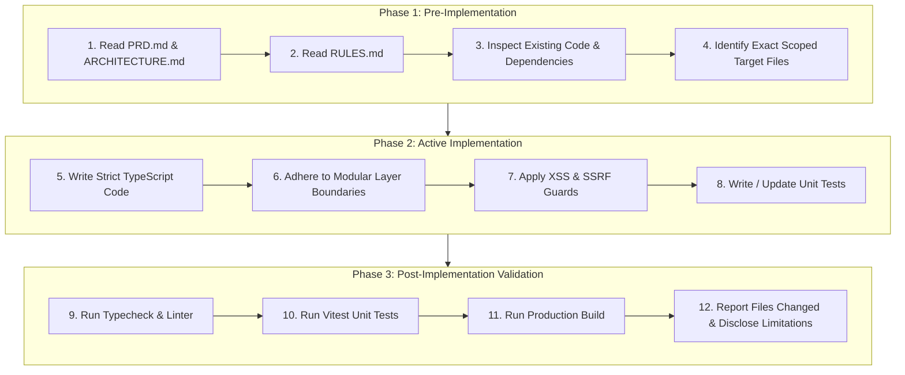

# Engineering Rules & Implementation Standards — CyberShield

**Document Identifier:** RULES-CYBER-SHIELD-001  
**Product Name:** CyberShield (Enhanced MVP)  
**Document Version:** 1.0.0-ENFORCEABLE  
**Status:** Mandatory & Active  
**Cross-References:** [`PRD.md`](file:///c:/Users/Bhuvan%20A/OneDrive/Desktop/project/projectt/PRD.md) | [`ARCHITECTURE.md`](file:///c:/Users/Bhuvan%20A/OneDrive/Desktop/project/projectt/ARCHITECTURE.md)  
**Target Audience:** Autonomous AI Coding Agents, Software Engineers, Code Reviewers, Application Security Auditors  

---

## 1. Document Purpose and Scope

### 1.1 Purpose
This document establishes the authoritative, mandatory coding standards, architectural guardrails, security boundaries, and operational constraints that govern the implementation, testing, modification, and maintenance of **CyberShield**. It serves as the persistent contract between product specifications and technical execution.

### 1.2 Hierarchy of Authority
To eliminate ambiguity when resolving implementation questions, developers and AI coding agents must observe the following hierarchy of truth:

```
┌────────────────────────────────────────────────────────┐
│ 1. PRD.md: Defines WHAT the product must accomplish.   │
├────────────────────────────────────────────────────────┤
│ 2. ARCHITECTURE.md: Defines HOW the system is designed.│
├────────────────────────────────────────────────────────┤
│ 3. RULES.md: Defines the STANDARDS code must follow.   │
└────────────────────────────────────────────────────────┘
```

When instructions appear in conflict:
1. Preserve explicit project requirements and security boundaries defined in [`PRD.md`](file:///c:/Users/Bhuvan%20A/OneDrive/Desktop/project/projectt/PRD.md).
2. Adhere to architectural layers and component limits defined in [`ARCHITECTURE.md`](file:///c:/Users/Bhuvan%20A/OneDrive/Desktop/project/projectt/ARCHITECTURE.md).
3. Apply the specific implementation rules defined in this document (`RULES.md`).
4. Stop and request clarification if a material conflict or irreversible assumption cannot be resolved safely.

### 1.3 Terminology & Conformance Language
The key words **MUST**, **MUST NOT**, **SHOULD**, **SHOULD NOT**, and **MAY** in this document are to be interpreted as follows:
- **MUST / MUST NOT:** Absolute, non-negotiable requirements or prohibitions. Violations will result in rejected code reviews or build failures.
- **SHOULD / SHOULD NOT:** Strongly recommended practices. Any departure requires documented technical justification.
- **MAY:** Truly optional choices left to developer discretion within established design patterns.
- **Rule Identifiers:** Critical rules carry stable identifiers (e.g., `RULE-001`) for traceability in code comments, test suites, and pull request audits.

---

## 2. Project Understanding and Scope Protection

- **RULE-001 (Requirements Prior Knowledge):** AI coding agents and developers **MUST** read and understand [`PRD.md`](file:///c:/Users/Bhuvan%20A/OneDrive/Desktop/project/projectt/PRD.md) and [`ARCHITECTURE.md`](file:///c:/Users/Bhuvan%20A/OneDrive/Desktop/project/projectt/ARCHITECTURE.md) before writing, modifying, or refactoring code.
- **RULE-002 (Scope Preservation):** The implementation **MUST** strictly fulfill the MVP scope. Developers **MUST NOT** introduce unapproved features (e.g., AI/LLM models, external paid threat-intel feeds, automated crawler engines, binary APK decompilation, user login portals, or automatic police FIR dispatchers).
- **RULE-003 (Zero Scope Reduction):** Developers **MUST NOT** arbitrarily remove, mock out, or bypass mandatory requirements (e.g., omitting Indian cybercrime helpline 1930 resources, replacing real heuristic regex scoring with fixed demonstration stubs, or bypassing URL structure checks).
- **RULE-004 (Assumption Disclosure):** When an underspecified requirement arises, developers **MUST NOT** silently invent sweeping architecture changes. They **MUST** log the assumption as a reversible proposal and preserve baseline system constraints.
- **RULE-005 (Truth in Implementation):** Developers **MUST NOT** claim functionality is complete, integrated, or tested when it relies on hardcoded placeholders or unexecuted mock data.

---

## 3. General Coding Principles

- **RULE-010 (Simplicity Over Cleverness):** Write straightforward, explicit, self-documenting code. Avoid esoteric syntax, deep inheritance, or speculative abstractions that hinder maintainability.
- **RULE-011 (Separation of Concerns):** Keep presentation code (React JSX), state management (hooks), domain business logic (heuristics, scoring formulas), and infrastructure clients (Supabase) in distinct, decoupled modules.
- **RULE-012 (Single Responsibility):** Each function, module, or component **MUST** have one well-defined responsibility. If a function performs validation, score calculation, and UI updates, it **MUST** be factored into distinct single-purpose functions.
- **RULE-013 (DRY Principle with Context):** Deduplicate identical domain calculations and utility functions. However, do not introduce premature generic abstractions for components that share superficial visual similarities but distinct functional lifecycles.
- **RULE-014 (Deterministic Execution):** Domain logic functions (normalization, rule matching, risk scoring) **MUST** be pure functions without hidden side effects. Given the same normalized input, the engine **MUST** return the exact same output every time.

---

## 4. Technology Stack Rules

- **RULE-020 (Approved Stack Exclusivity):** Developers **MUST** use only the approved technologies:
  - **Frontend:** React 18, Vite, TypeScript.
  - **Routing:** React Router v6.
  - **Server State:** TanStack Query (React Query) v5.
  - **Styling & Components:** Tailwind CSS, shadcn/ui (Radix primitives).
  - **Scrolling & Animation:** Lenis (smooth scroll), Framer Motion (components), GSAP with ScrollTrigger (scroll storytelling).
  - **BaaS:** Supabase (PostgreSQL, Edge Functions).
  - **Hosting:** Vercel.
- **RULE-021 (No Node.js/Express Backend):** Developers **MUST NOT** introduce an independent Express, NestJS, or custom Node.js server. Backend responsibilities belong to Supabase Edge Functions and PostgreSQL.
- **RULE-022 (No Competing Libraries):** Developers **MUST NOT** introduce redundant or conflicting libraries (e.g., Redux, MobX, Axios, Bootstrap, Chakra UI, Emotion, or alternative smooth-scroll plugins).

---

## 5. TypeScript Rules

- **RULE-030 (Strict Mode Enforcement):** The TypeScript configuration **MUST** enforce `"strict": true`, `"noImplicitAny": true`, `"strictNullChecks": true`, and `"noUnusedLocals": true`.
- **RULE-031 (Prohibition of `any`):** The `any` type is strictly **PROHIBITED**. Developers **MUST** use precise types, generics, or `unknown` with runtime type narrowing:
  ```typescript
  // VIOLATION:
  function parseData(input: any): any { ... }

  // COMPLIANT:
  function parseData(input: unknown): ThreatAssessmentResult { ... }
  ```
- **RULE-032 (Domain Contract Typing):** All inputs, findings, rules, severity levels, and assessment results **MUST** be explicitly typed using the contracts established in [`ARCHITECTURE.md`](file:///c:/Users/Bhuvan%20A/OneDrive/Desktop/project/projectt/ARCHITECTURE.md#151-client-side-typescript-interface-contracts).
- **RULE-033 (Discriminated Unions for States):** Use discriminated unions for representing mutually exclusive states (e.g., `status: 'idle' | 'loading' | 'success' | 'error'`).
- **RULE-034 (Runtime vs Compile-time Boundaries):** Developers **MUST NOT** assume TypeScript types provide runtime protection. Untrusted data originating from user input or external APIs **MUST** be validated at runtime via schemas (e.g., Zod) or explicit validation functions before engine processing.

---

## 6. React Component Rules

- **RULE-040 (Functional Components Only):** All React components **MUST** be functional components using hooks. Class components are prohibited except for top-level `ErrorBoundary` implementations.
- **RULE-041 (No Business Logic in Views):** React components **MUST NOT** execute raw regex searches, calculate mathematical risk scores, or build recommendations directly inside JSX. All threat assessment logic **MUST** be delegated to hooks (`useThreatAnalysis`) calling domain modules.
- **RULE-042 (Controlled Inputs):** Form inputs for text messages, URLs, and application metadata **MUST** be strictly controlled components with explicit value and change handler bindings.
- **RULE-043 (Stable List Keys):** When rendering lists of findings, recommendations, or quiz questions, developers **MUST** use stable unique IDs (e.g., `rule.ruleId`, `question.id`). Using array indices as keys (`key={index}`) is **PROHIBITED** on dynamic or filterable lists.
- **RULE-044 (Proper Hook Dependencies):** `useEffect`, `useCallback`, and `useMemo` hooks **MUST** explicitly declare all dependencies. Suppressing `react-hooks/exhaustive-deps` using eslint comments is **PROHIBITED** without documented justification.
- **RULE-045 (Rendering Performance):** Pure presentational sub-components (such as individual finding cards or static checklist items) **SHOULD** be memoized (`React.memo`) where appropriate to prevent unnecessary re-renders during high-frequency text input.

---

## 7. Routing Rules

- **RULE-050 (Centralized Route Registry):** Route paths and their respective components **MUST** be declared centrally in `src/app/routes.tsx`. Hardcoded route strings scattered across UI buttons are discouraged; use named route constants or helper functions.
- **RULE-051 (The 7 Approved Routes):** The application **MUST** contain exactly the 7 functional routes specified in the PRD:
  1. `/` (Home Dashboard)
  2. `/analyze` (Threat Input Form)
  3. `/analyze/results` (Analysis Results View — or stateful view on `/analyze`)
  4. `/awareness` (Threat Awareness Center)
  5. `/safety-guide` (Safety Guide & Indian Incident Escalation)
  6. `/training` (Interactive Simulations & Knowledge Quiz)
  7. `/about` (Methodology, Privacy & Limitations)
  8. `*` (Catch-all 404 Not Found Page)
- **RULE-052 (No Unauthenticated Guards):** Since the MVP excludes authentication, developers **MUST NOT** inject protected route guards, dummy login redirects, or fake auth gates.

---

## 8. State Management and Data Fetching Rules

- **RULE-060 (Ephemeral Form State):** User-submitted message text, URLs, and application selections **MUST** be stored exclusively in ephemeral React component state (`useState` or `useReducer`). They **MUST NOT** be synchronized with `localStorage`, session storage, or external databases.
- **RULE-061 (TanStack Query Scope):** TanStack Query **MUST** be reserved for asynchronous server operations (e.g., Supabase Edge Function calls, feedback submissions). Do not wrap purely synchronous local state in query client stubs.
- **RULE-062 (Query Key Conventions):** All TanStack Query keys **MUST** be structured as serializable arrays using hierarchical namespacing (e.g., `['feedback', 'submission']`).
- **RULE-063 (Safe Mutation Retries):** Non-idempotent mutations (e.g., submitting user feedback) **MUST NOT** be configured with automatic infinite retries (`retry: 0` or `retry: 1` maximum) to prevent duplicate submissions on flaky networks.

---

## 9. Styling and UI Component Rules

- **RULE-070 (Tailwind & shadcn/ui Exclusivity):** Styling **MUST** be accomplished using Tailwind CSS utility classes and `shadcn/ui` component primitives located in `src/components/ui/`.
- **RULE-071 (No Inline CSS Styles):** Inline `style={{ ... }}` attributes are **PROHIBITED**, except for dynamic mathematical positions or angles required by SVG gauges (e.g., stroke-dashoffset).
- **RULE-072 (Semantic Color Tokens):** Threat severity levels **MUST** use consistent, semantic color palettes:
  - **Low Risk (0–24):** Emerald / Green (`text-emerald-500`, `bg-emerald-500/10`, `border-emerald-500/20`).
  - **Moderate Risk (25–49):** Amber / Yellow (`text-amber-500`, `bg-amber-500/10`, `border-amber-500/20`).
  - **High Risk (50–74):** Orange (`text-orange-500`, `bg-orange-500/10`, `border-orange-500/20`).
  - **Very High Risk (75–100):** Rose / Red (`text-rose-500`, `bg-rose-500/10`, `border-rose-500/20`).
- **RULE-073 (Theme and Dark Mode Support):** All components **MUST** render with high contrast and legibility in both light and dark themes, defaulting to a dark-mode-first aesthetic.

---

## 10. Animation and Scrolling Rules

- **RULE-080 (Strict Tool Segregation):** Developers **MUST** observe the non-overlapping boundaries for motion libraries:
  - **Lenis:** Handles global browser window scrolling only.
  - **Framer Motion:** Handles component-level micro-interactions, layout transitions, tab changes, and accordion expansions.
  - **GSAP & ScrollTrigger:** Handles pinned narrative storytelling sections in `/awareness`.
- **RULE-081 (Reduced Motion Compliance):** All animation implementations **MUST** support the `prefers-reduced-motion` media query. When reduced motion is preferred, animations **MUST** be disabled or simplified to immediate zero-duration state changes.
- **RULE-082 (No Functional Dependency on Animation):** Core application functionality (form submission, scoring, quiz checking, link extraction) **MUST** remain 100% functional even if JavaScript animation libraries fail to load or are blocked by browser extensions.
- **RULE-083 (Resource Cleanup):** All GSAP ScrollTrigger instances and Lenis listeners **MUST** be cleanly destroyed in React cleanup functions (`useEffect` return callback) to prevent memory leaks during page navigation.

---

## 11. Business Logic Rules

- **RULE-090 (Modular Rule Isolation):** Threat detection rules **MUST** be implemented as isolated, typed objects conforming to the `DetectionRule` interface. Adding, modifying, or disabling a rule **MUST NOT** require modifying core scoring math.
- **RULE-091 (Deterministic Scoring Formula):** The risk score **MUST** be calculated using the normalized mathematical formula defined in [`ARCHITECTURE.md`](file:///c:/Users/Bhuvan%20A/OneDrive/Desktop/project/projectt/ARCHITECTURE.md#102-mathematical-scoring-model). The raw score **MUST** be bounded between $0$ and $100$. Floating point results **MUST** be rounded to the nearest integer.
- **RULE-092 (Indicator Deduplication):** If a message contains multiple repetitions of the same trigger keyword (e.g., the word "OTP" appears 4 times), the associated rule weight **MUST** be added exactly once. Artificial score inflation via repetitive keyword spamming is strictly **PROHIBITED**.
- **RULE-093 (Contextual Attenuation):** When educational, advisory, or reporting language is detected alongside threat indicators (e.g., "Beware of fake police arrest calls"), the engine **MUST** apply the contextual multiplier ($C_{\text{context}} = 0.4$) and append an informative advisory badge.
- **RULE-094 (Uncertainty Handling):** Submissions consisting of fewer than 3 words or ambiguous text yielding zero rule matches **MUST** return `isInconclusive: true` with a score of $0$ and explicit instructions for the user to provide more context.
- **RULE-095 (Actionable Recommendations):** Every negative finding **MUST** be mapped directly to a concrete defensive recommendation. General boilerplate recommendations must not be displayed in isolation if specific threats were identified.
- **RULE-096 (No Fabricated Intelligence):** The engine **MUST NOT** fabricate confidence percentages, simulate fake network latency, or display unverified threat intelligence data.

---

## 12. Supabase and Database Rules

- **RULE-100 (Zero Persistence of Analysis Content):** User-submitted messages, raw URLs, and application selections **MUST NOT** be saved to any database table, cookie, or server log.
- **RULE-101 (Row Level Security Mandatory):** Every table created in Supabase PostgreSQL (e.g., `analysis_feedback`) **MUST** have Row Level Security enabled (`ALTER TABLE ... ENABLE ROW LEVEL SECURITY;`).
- **RULE-102 (Least Privilege Policies):** Tables accepting user feedback **MUST** allow only `INSERT` operations for anonymous clients (`TO anon WITH CHECK (true)`). Reading (`SELECT`), modifying (`UPDATE`), or deleting (`DELETE`) feedback rows **MUST** be denied to the public role.
- **RULE-103 (Database Constraints):** All database columns **MUST** define appropriate data types and constraints (`CHECK`, `NOT NULL`, `FOREIGN KEY`). Text input columns **MUST** have hard length limits (e.g., `CHECK (length(sanitized_comment) <= 500)`).
- **RULE-104 (Migration Integrity):** Database changes **MUST** be written as repeatable, version-controlled SQL migration scripts stored in `supabase/migrations/`. Manual ad-hoc schema editing in the Supabase Dashboard is prohibited for production releases.

---

## 13. Backend and Edge Function Rules

- **RULE-110 (Deno Runtime Compliance):** Supabase Edge Functions **MUST** be written in TypeScript for the Deno runtime, observing Deno import conventions and standard library versions.
- **RULE-111 (Payload Validation):** Edge Functions **MUST** validate incoming HTTP request methods, headers, and JSON bodies before executing any operations. Malformed or oversized payloads ($> 10\text{ KB}$) **MUST** be rejected immediately with HTTP 400 Bad Request.
- **RULE-112 (CORS Headers):** Edge Functions **MUST** return strict Cross-Origin Resource Sharing (CORS) headers restricting origin access to authorized domains in production:
  ```typescript
  const corsHeaders = {
    'Access-Control-Allow-Origin': Deno.env.get('ALLOWED_ORIGIN') ?? '*',
    'Access-Control-Allow-Headers': 'authorization, x-client-info, apikey, content-type',
  };
  ```
- **RULE-113 (Safe Error Responses):** Edge Functions **MUST NOT** return raw stack traces or internal SQL errors to the client. Responses must use standardized, sanitized JSON error payloads.

---

## 14. Security Rules

- **RULE-120 (Safe Text Rendering — XSS Prevention):** All user-supplied inputs, matched substrings, and extracted URLs **MUST** be rendered strictly as standard text within React DOM elements. The use of `dangerouslySetInnerHTML` is **STRICTLY PROHIBITED** across the entire codebase.
- **RULE-121 (Zero Outbound URL Fetching — SSRF Prevention):** The system **MUST NEVER** execute `fetch()`, `axios.get()`, or any automated network connection to user-submitted URLs. Analysis is performed strictly by parsing string components (scheme, hostname, port, path, TLD) using the browser's built-in `URL` API and offline regex heuristics.
- **RULE-122 (No Executable Binary Parsing):** Application analysis **MUST** accept only structured metadata strings (app name, claimed publisher, source, declared permissions). Uploading or executing binary `.apk`, `.exe`, or `.dex` files is **PROHIBITED**.
- **RULE-123 (Secret Management):** Under no circumstances shall service role keys (`SUPABASE_SERVICE_ROLE_KEY`), internal database passwords, or personal access tokens be committed to git or exposed via client-side `VITE_` environment variables.
- **RULE-124 (Content Security Policy):** The production deployment **MUST** include a strict CSP header in `vercel.json` banning `unsafe-eval` and restricting script/connect sources to authorized domains.

---

## 15. Privacy and Data Handling Rules

- **RULE-130 (Data Minimization):** The application **MUST** collect the absolute minimum data required to perform threat triage. No user tracking, behavioral analytics, or device fingerprinting libraries are permitted.
- **RULE-131 (Log Sanitization):** Console logging in production builds (`console.log`, `console.info`) **MUST** be stripped using Vite build options. In development, logs **MUST NEVER** output raw OTPs, credit card numbers, passwords, or personal identification data.
- **RULE-132 (Prominent Privacy Notice):** The threat analysis interface **MUST** feature a visible privacy notice explaining that inputs are processed locally in volatile browser memory and are never stored or logged.

---

## 16. Error Handling and Logging Rules

- **RULE-140 (No Silent Failures):** Errors **MUST NOT** be caught and silently swallowed without appropriate UI feedback or error handling.
- **RULE-141 (No Fallback Fabrication):** If the detection engine encounters an unhandled exception during processing, it **MUST NOT** return a fake "Low Risk" or "Safe" result. It **MUST** transition the UI into an explicit error state informing the user that analysis could not be completed.
- **RULE-142 (User-Friendly Error Copy):** Error messages displayed to users **MUST** be written in clear, non-technical, reassuring language, accompanied by actionable recovery steps (e.g., "We could not analyze this URL because the format is invalid. Please ensure it begins with https://").

---

## 17. File and Directory Organization Rules

- **RULE-150 (Structural Directory Adherence):** Code **MUST** be organized strictly according to the structure defined in [`ARCHITECTURE.md`](file:///c:/Users/Bhuvan%20A/OneDrive/Desktop/project/projectt/ARCHITECTURE.md#71-recommended-directory-structure):
  - `src/engine/`: Pure domain heuristics, scoring, and text preprocessors. (Must have 0 UI dependencies).
  - `src/features/`: Feature modules (`analysis`, `awareness`, `safety`, `training`).
  - `src/components/ui/`: Reusable `shadcn/ui` primitives.
  - `src/components/layout/`: Shared layout headers, footers, containers.
  - `src/lib/`: Configured library instances (e.g., `supabase.ts`).
  - `src/app/`: Application router, providers, and root components.
- **RULE-151 (Forbidden File Placement):** Domain detection rules **MUST NOT** be placed inside UI component folders. UI components **MUST NOT** be placed inside `src/engine/`.
- **RULE-152 (No Multi-Thousand-Line God Files):** Source files **SHOULD NOT** exceed 350 lines of code. Large rule dictionaries or simulation banks **MUST** be split into logical sub-modules (e.g., `rules/phishing.ts`, `rules/digital-arrest.ts`).

---

## 18. Naming and Code Organization Rules

- **RULE-160 (Component Naming):** React components **MUST** use PascalCase (e.g., `ScoreGauge.tsx`, `IncidentChecklist.tsx`).
- **RULE-161 (Hook Naming):** Custom React hooks **MUST** use camelCase prefixed with `use` (e.g., `useThreatAnalysis.ts`, `useQuizSession.ts`).
- **RULE-162 (Domain Rule Naming):** Rule definitions **MUST** use screaming snake_case prefixed by category:
  - `RULE_PHISH_*` (Phishing rules)
  - `RULE_ARREST_*` (Digital arrest rules)
  - `RULE_URL_*` (URL structure rules)
  - `RULE_APP_*` (Application metadata rules)
- **RULE-163 (Type and Interface Naming):** Types and interfaces **MUST** use PascalCase (e.g., `ThreatAssessmentResult`, `DetectionRule`). Do not prefix interfaces with `I` (e.g., use `DetectionRule`, not `IDetectionRule`).
- **RULE-164 (Constant Naming):** Application constants and regex definitions **MUST** use screaming snake case (e.g., `MAX_MESSAGE_LENGTH`, `REGEX_URL_EXTRACTION`).

---

## 19. Dependency Management Rules

- **RULE-170 (Minimal Dependency Footprint):** Do not install third-party npm packages when standard browser APIs or lightweight utility functions suffice.
- **RULE-171 (Lockfile Integrity):** The project lockfile (`package-lock.json`) **MUST** be committed and maintained. Package installations **MUST** be executed with compatible version flags.
- **RULE-172 (No Deprecated or High-Risk Packages):** Packages with known high-severity vulnerabilities, abandoned maintenance, or invasive native bindings are strictly **PROHIBITED**.

---

## 20. Testing Rules

- **RULE-180 (Domain Engine Unit Coverage):** 100% of detection rules, regex patterns, text normalizers, scoring formulas, and deduplication logic **MUST** have automated unit tests written in Vitest.
- **RULE-181 (Deterministic Assertion Standards):** Tests **MUST** assert exact expected scores, matched evidence substrings, and classifications. Never write loose assertions like `expect(score).toBeGreaterThan(0)` when a specific formula is prescribed.
- **RULE-182 (Benchmark Test Corpus Execution):** Prior to production release, the engine **MUST** pass the benchmark test suite comprising 50 verified malicious samples and 25 benign controls, achieving:
  - Precision $\ge 90\%$
  - Recall $\ge 85\%$
  - False Positive Rate on Benign Controls $\le 8\%$
- **RULE-183 (No Test Weakening):** Developers **MUST NOT** modify, delete, or comment out existing test cases simply to make a failing build pass. If a test fails, the implementation must be corrected.

---

## 21. Code Quality and Validation Rules

- **RULE-190 (Mandatory Local Validation):** Before any code is declared complete, the following commands **MUST** pass with zero errors and zero warnings:
  ```bash
  # 1. Type validation
  npm run typecheck   # or: npx tsc --noEmit

  # 2. Linter verification
  npm run lint

  # 3. Automated test execution
  npm run test        # or: npx vitest run

  # 4. Production build compilation
  npm run build
  ```
- **RULE-191 (No Compiler Suppression):** The use of `@ts-ignore`, `@ts-nocheck`, or `eslint-disable` is strictly **PROHIBITED** unless accompanied by an explicit, approved architectural comment explaining the unavoidable third-party typing defect.

---

## 22. Accessibility and Responsive Behavior Rules

- **RULE-200 (WCAG 2.1 AA Compliance):** All UI components **MUST** comply with WCAG 2.1 Level AA standards:
  - Interactive elements **MUST** have visible focus rings (`focus-visible:ring-2`).
  - Form fields **MUST** have accessible labels (`<label htmlFor="...">` or `aria-label`).
  - Text-to-background contrast ratio **MUST** be at least 4.5:1 for normal text and 3:1 for large text.
- **RULE-201 (Non-Color Threat Indicators):** Threat classifications **MUST NOT** rely solely on color. Every risk badge **MUST** display an explicit text label (e.g., "Very High Risk") and a distinct icon alongside the color badge.
- **RULE-202 (Responsive Mobile-First Design):** The application **MUST** be fully functional and visually stable on viewport widths from $320\text{px}$ (small mobile) to $2560\text{px}$ (ultra-wide desktop). Touch targets on mobile devices **MUST** be at least $44 \times 44\text{px}$.

---

## 23. Configuration and Environment Rules

- **RULE-210 (Environment Segregation):** Public configuration variables injected into Vite **MUST** be prefixed with `VITE_` (e.g., `VITE_SUPABASE_URL`, `VITE_SUPABASE_ANON_KEY`).
- **RULE-211 (Missing Variable Handling):** The application **MUST** check for required environment variables during bootstrap and throw an informative, safe error if a critical key is undefined:
  ```typescript
  // src/lib/supabase.ts
  const supabaseUrl = import.meta.env.VITE_SUPABASE_URL;
  const supabaseAnonKey = import.meta.env.VITE_SUPABASE_ANON_KEY;

  if (!supabaseUrl || !supabaseAnonKey) {
    console.warn("Supabase credentials missing. Running in offline/mock mode.");
  }
  ```

---

## 24. Git and Change Management Rules

- **RULE-220 (Focused Diffs):** Each change or pull request **MUST** focus exclusively on the specific task. Do not reformat unrelated files, change line endings, or reorganize project directories outside the task scope.
- **RULE-221 (Clean History & No Secrets):** Developers **MUST NOT** commit `.env`, `.env.local`, `.DS_Store`, `node_modules/`, or build artifacts (`dist/`). Ensure `.gitignore` is properly configured before staging files.
- **RULE-222 (Preservation of User Work):** AI agents **MUST NOT** delete, overwrite, or reset working code or configuration files created by human collaborators without explicit instruction.

---

## 25. AI Coding-Agent Operating Rules

When operating autonomously on the CyberShield codebase, AI agents **MUST** execute tasks through a disciplined three-phase workflow:



### 25.1 Phase 1: Pre-Implementation
1. Read the relevant user prompt and locate corresponding sections in [`PRD.md`](file:///c:/Users/Bhuvan%20A/OneDrive/Desktop/project/projectt/PRD.md) and [`ARCHITECTURE.md`](file:///c:/Users/Bhuvan%20A/OneDrive/Desktop/project/projectt/ARCHITECTURE.md).
2. Inspect the current workspace structure to identify existing utilities and components.
3. Formulate the minimal set of files requiring creation or modification.

### 25.2 Phase 2: Active Implementation
1. Write clean, modular, typed code adhering to the approved tech stack.
2. Ensure new rules or features reside in the correct architectural directory (`src/engine/` for domain logic, `src/features/` for UI).
3. Strictly implement safe text rendering; never add network fetch routines for user URLs.
4. Implement corresponding unit tests for any new or modified business logic.

### 25.3 Phase 3: Post-Implementation Validation
1. Execute `npx tsc --noEmit` to verify type integrity.
2. Execute `npx vitest run` to verify that all unit and regression tests pass.
3. Execute `npm run build` to ensure the production Rollup bundle compiles cleanly without warnings.
4. Provide a transparent summary report detailing:
   - Specific files modified or created.
   - Exact test commands executed and their results.
   - Any unverified external assumptions or identified edge cases.

---

## 26. Prohibited Practices

The following actions are **STRICTLY PROHIBITED** and constitute immediate grounds for rejection:
1. **PROHIBITED:** Integrating LLM or Generative AI APIs (OpenAI, Gemini, Anthropic) into the detection engine without an authorized PRD revision.
2. **PROHIBITED:** Making automated outbound network requests to submitted URLs (crawling, pinging, or fetching).
3. **PROHIBITED:** Persisting raw user-submitted message content or URLs in PostgreSQL, cookies, or remote server logs.
4. **PROHIBITED:** Using `dangerouslySetInnerHTML` to render user text, extracted URLs, or rule evidence.
5. **PROHIBITED:** Claiming actual binary APK decompilation or malware file scanning when only permission metadata is analyzed.
6. **PROHIBITED:** Adding a custom Node.js, Express, or Fastify backend server.
7. **PROHIBITED:** Hardcoding fake, static risk scores or mock findings to simulate engine operation.
8. **PROHIBITED:** Disabling Row Level Security (RLS) on Supabase database tables.
9. **PROHIBITED:** Committing Supabase service role keys or production credentials to git.
10. **PROHIBITED:** Silently altering the approved technology stack or introducing unauthorized state-management libraries.

---

## 27. Exceptions and Rule Changes

If a technical constraint necessitates an exception to any rule in this document:
1. The developer or agent **MUST NOT** silently ignore or bypass the rule.
2. An **Exception Request Record** must be documented containing:
   - **Target Rule ID** (e.g., `RULE-071`).
   - **Technical Justification:** Why the rule cannot be complied with in this instance.
   - **Security & Privacy Impact Assessment:** Proof that the exception introduces no vulnerabilities or data leaks.
   - **Alternatives Evaluated:** Why other compliant approaches failed.
   - **Approval Status:** Explicitly approved by the Lead Architect.

---

## 28. Definition of Done (DoD)

A task, feature, or pull request is formally defined as **DONE** only when all of the following conditions are verified:
- [ ] Feature matches the functional specifications defined in [`PRD.md`](file:///c:/Users/Bhuvan%20A/OneDrive/Desktop/project/projectt/PRD.md).
- [ ] Code adheres strictly to the architectural boundaries in [`ARCHITECTURE.md`](file:///c:/Users/Bhuvan%20A/OneDrive/Desktop/project/projectt/ARCHITECTURE.md).
- [ ] 100% of applicable rules in this document (`RULES.md`) are satisfied.
- [ ] No `any` types, `@ts-ignore` comments, or lint warnings exist.
- [ ] Vitest unit tests cover new domain logic, scoring math, and edge cases.
- [ ] Zero raw user messages or URLs are persisted or logged.
- [ ] Safe text rendering is verified across all user-facing outputs.
- [ ] Responsive design verified from mobile ($375\text{px}$) to desktop ($1440\text{px}$).
- [ ] `npm run build` compiles a clean production bundle.

---

## 29. Final Compliance Checklist

AI coding agents and developers must execute this checklist before submitting or concluding work:

### Category A: Requirements & Architecture
- [ ] Does this implementation preserve the approved Enhanced MVP scope without unrequested additions? (RULE-002)
- [ ] Is domain logic strictly isolated in `src/engine/` without React UI dependencies? (RULE-041, RULE-150)
- [ ] Are all 7 application routes operational without unauthorized authentication gates? (RULE-051, RULE-052)

### Category B: Security & Privacy
- [ ] Are all user inputs, matched substrings, and URLs rendered safely without `dangerouslySetInnerHTML`? (RULE-120)
- [ ] Is automated outbound fetching of user URLs completely absent from the code? (RULE-121)
- [ ] Is user-submitted content processed transiently in RAM with zero database storage? (RULE-100, RULE-130)
- [ ] Are all Supabase tables secured with Row Level Security (RLS)? (RULE-101)
- [ ] Are all service role keys strictly absent from client-side bundles? (RULE-123, RULE-210)

### Category C: Code Quality & Testing
- [ ] Does the TypeScript code compile cleanly under strict mode with zero `any` types? (RULE-030, RULE-031)
- [ ] Do detection rules execute deterministically with proper deduplication? (RULE-014, RULE-092)
- [ ] Are Vitest unit tests added for all new detection heuristics and scoring algorithms? (RULE-180, RULE-181)
- [ ] Have `npm run typecheck`, `npm run lint`, and `npm run test` passed successfully? (RULE-190)
- [ ] Did `npm run build` succeed with no packaging warnings or bundle size regressions? (RULE-190)
